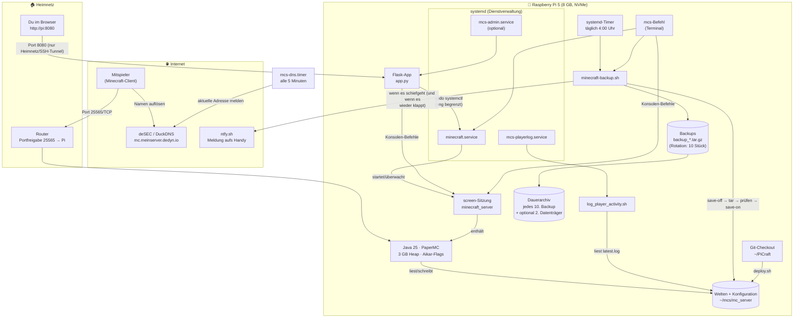
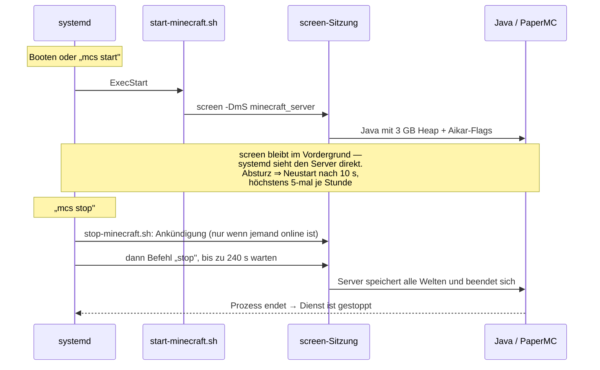
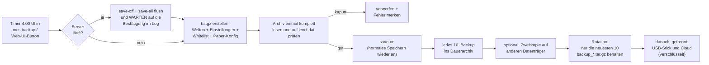

# PiCraft — Minecraft-Server für den Raspberry Pi 5


-6cc24a)


Ein kompletter, wartungsarmer [PaperMC](https://papermc.io)-Server für den
Raspberry Pi 5. Einmal installieren, danach läuft alles von selbst: Autostart
beim Booten, automatischer Neustart bei Abstürzen, nächtliche Backups mit
Rotation und Prüfung, und eine Weboberfläche fürs Handy.

Das Prinzip: **so einfach wie möglich, so komplex wie nötig.**

## Loslegen

```sh
git clone https://github.com/Auktoriator/PiCraft.git
cd PiCraft
./install.sh
```

Das war es. Der Assistent führt durch sechs Schritte, erklärt jede Einstellung
und schlägt einen Wert vor — die Eingabetaste übernimmt ihn:

```
  PiCraft  ·  Minecraft-Server für den Raspberry Pi
  ────────────────────────────────────────────────────────────

  Schritt 5 von 6 · Speicher und Backups

  Dieses Gerät hat 8 GB Arbeitsspeicher.

  Mehr Heap macht einen Minecraft-Server NICHT schneller — er verlängert
  nur die Pausen der Speicherbereinigung. Der Rest ist beim Betriebssystem
  als Dateicache besser aufgehoben. Empfohlen sind daher 3 GB.

  > Arbeitsspeicher für Minecraft in GB (Enter = 3): _
```

Am Ende steht eine Zusammenfassung. **Bis dahin wird nichts verändert** —
abbrechen ist folgenlos.

Wer keine Fragen mag: `./install.sh --standard` nimmt überall die Empfehlung.
Wer die Weboberfläche nicht will: `./install.sh --ohne-oberflaeche` — das gilt
auch im Schnellmodus, wo sonst überall die Empfehlung („ja") greift.

> **Als Erstes wird gefragt, wohin.** Vorschlag ist `~/mcs`. Wer eine SSD an
> anderer Stelle eingehängt hat, trägt sie dort ein — das ist die wirksamste
> Einzelentscheidung des ganzen Assistenten, und die Auskunft über das
> Speichermedium steht direkt darüber. Gefragt wird nur bei einer frischen
> Installation; eine bestehende behält ihren Ort.

### Danach

| Was | Befehl |
|---|---|
| Läuft alles? | `mcs status` |
| Spieler einladen | `mcs cmd "whitelist add NAME"` |
| Kommen sie rein? | `mcs erreichbarkeit` |
| Zusehen | `mcs log` |
| Alle Befehle | `mcs hilfe` |

> **Damit Freunde mitspielen können, fehlen noch zwei Dinge.** Beide haben
> nichts mit dem Pi zu tun, und beide übersieht man leicht:
>
> 1. **Port 25565/TCP im Router auf den Pi weiterleiten.** Ohne das kommt
>    niemand von außen an. Wo das im Router steht, heißt je nach Hersteller
>    „Portfreigabe", „Port Forwarding" oder „Virtueller Server".
> 2. **Einen Namen einrichten**, unter dem der Server immer erreichbar ist —
>    die Adresse der meisten Anschlüsse ändert sich regelmäßig.
>
> Und ein dritter Punkt, den die Anleitungen im Netz meist verschweigen:
> **Bei vielen deutschen Anschlüssen ist die Portfreigabe wirkungslos.**
> Kabel- und viele Glasfaseranschlüsse haben gar keine eigene öffentliche
> IPv4-Adresse (*DS-Lite*). Dort kann man freigeben, so oft man will.
>
> `mcs erreichbarkeit` sagt, was von beidem zutrifft — statt es raten zu
> lassen. Ausführlich: [Erreichbarkeit von außen](#erreichbarkeit-von-außen).

> **Etwas frisch installiert oder aktualisiert?** In
> [`PRUEFEN-AUF-DEM-PI.md`](PRUEFEN-AUF-DEM-PI.md) steht, was sich nur auf
> echter Hardware prüfen lässt — der automatische Test läuft im Container, wo
> systemd nicht als PID 1 arbeitet.

### Was drin ist

| | |
|---|---|
| Server | PaperMC 26.3 — Minecraft-Version fest in [`versions.env`](server/versions.env), den neuesten Build holt `mcs update` |
| Java | mindestens 21, empfohlen 25 — wird bei Bedarf mitinstalliert |
| Leistung | Aikar-Flags, angepasst und **auf einem Pi 5 nachgemessen** ([Protokoll](docs/optimierung-2026-07-27.md)) |
| Backups | nächtlich, geprüft, rotiert — plus ein Dauerarchiv, das nie gelöscht wird |
| Kopien außer Haus | USB-Stick einstecken, die LED sagt, wann er raus darf — oder verschlüsselt in die Cloud (Google Drive oder alles, was rclone kennt) |
| Plugins | Pl3xMap für die Weltkarte, mit Prüfsumme in [`plugins.txt.beispiel`](server/plugins.txt.beispiel). WorldEdit, WorldGuard und Chunky stehen dort als Vorschlag bereit. |
| Bedienung | ein Befehl `mcs` für alles, dazu eine Weboberfläche fürs Handy |
| Abschalten | `mcs aus` legt **alles** still — auch über einen Neustart hinweg |
| Verlauf | CPU, RAM, Temperatur, TPS: eine Woche Messwerte, minütlich |
| Sicherheit | Whitelist an, Firewall optional beim Installieren, Dienst läuft nie als root |
| Passwort | für die Weboberfläche selbst wählen — oder Eingabetaste für ein zufälliges mit 20 Zeichen |
| Updates | `unattended-upgrades` auf Wunsch — Sicherheitsupdates ja, Selbstneustart nein |
| Erreichbarkeit | Ein Test, der DS-Lite erkennt und benennt, statt „Port freigeben" zu wiederholen |
| Name im Internet | deSEC (mit SRV-Eintrag, also ohne Portangabe) oder DuckDNS |
| Meldung | Backup-Fehlschlag kommt aufs Handy (ntfy) — mit Entwarnung, wenn es wieder klappt |

### Wenn du nur eine Sache liest

Drei Dinge, bei denen das Naheliegende falsch ist:

1. **`install.sh` ist zum Einrichten, `deploy.sh` zum Ausrollen von
   Änderungen.** Beides ist gefahrlos mehrfach ausführbar. Aber
   `deploy.sh --konfig-uebernehmen` niemals ungeprüft — erst `--probe`.
2. **Die Welt heißt nicht `world`.** Der Name steht in `level-name` in
   `server.properties`. Wer Weltdaten sucht oder sichert, liest ihn dort —
   die Ordner `world*` können Altbestand sein.
3. **Ein Wechsel der Minecraft-Version ist endgültig.** Der erste Start wandelt
   die Weltdateien um, und die alte Serverversion kann sie danach nicht mehr
   öffnen. Deshalb steht die Version fest in `versions.env`. Ein neuer
   *Build* innerhalb derselben Version ist dagegen harmlos — den holt
   `mcs update` (oder der Knopf auf der Seite „Konfiguration") ohne Zusatz.

---

## Inhaltsverzeichnis

- [Loslegen](#loslegen)
- [Die vier Befehle, die man wirklich braucht](#die-vier-befehle-die-man-wirklich-braucht)
- [Voraussetzungen](#voraussetzungen)
- [Installation](#installation)
- [Änderungen ausrollen (Deploy)](#änderungen-ausrollen-deploy)
- [Server aktualisieren (Update)](#server-aktualisieren-update)
- [Backup wiederherstellen (Restore)](#backup-wiederherstellen-restore)
- [Architektur: Wie alles zusammenspielt](#architektur-wie-alles-zusammenspielt)
- [Bedienung: das Werkzeug `mcs`](#bedienung-das-werkzeug-mcs)
- [Die Komponenten im Detail](#die-komponenten-im-detail)
  - [Start und Stopp (systemd + screen)](#start-und-stopp-systemd--screen)
  - [Backups](#backups)
  - [Kopien außer Haus: USB-Stick und Cloud](#kopien-außer-haus-usb-stick-und-cloud)
  - [Plugins](#plugins)
  - [Spieler-Aktivitätslog](#spieler-aktivitätslog)
  - [Admin-Weboberfläche](#admin-weboberfläche)
- [Erreichbarkeit von außen](#erreichbarkeit-von-außen)
- [Ein Name statt einer Zahl (DNS)](#ein-name-statt-einer-zahl-dns)
- [Wenn ein Backup schiefgeht: die Meldung aufs Handy](#wenn-ein-backup-schiefgeht-die-meldung-aufs-handy)
- [Sicherheit](#sicherheit)
  - [RCON](#rcon)
  - [Wie weit die Weboberfläche zu trauen ist](#wie-weit-die-weboberfläche-zu-trauen-ist)
  - [SSH: Anmeldung per Schlüssel statt Passwort](#ssh-anmeldung-per-schlüssel-statt-passwort)
- [Zugriff über Tailscale](#zugriff-über-tailscale)
- [Die Weltkarte öffentlich erreichbar machen](#die-weltkarte-öffentlich-erreichbar-machen)
- [Performance](#performance)
- [Troubleshooting](#troubleshooting)
- [Verzeichnisstruktur](#verzeichnisstruktur)
- [Auf echter Hardware prüfen](#auf-echter-hardware-prüfen)
- [Für Entwickler: Prüfungen und Abnahmetest](#für-entwickler-prüfungen-und-abnahmetest)
  - [Drei Fallen, die der Container nicht sieht](#drei-fallen-die-der-container-nicht-sieht)
- [Lizenz](#lizenz)

---

## Die vier Befehle, die man wirklich braucht

| Situation | Befehl |
|---|---|
| Ich habe etwas im Repository geändert | `./deploy.sh` (im Checkout), danach `mcs restart` |
| Ich will Paper aktuell halten | `mcs update`, danach `mcs restart` — oder der Knopf auf der Seite „Konfiguration" |
| Etwas ist kaputt, ich will ein Backup zurück | `mcs stop`, dann `mcs restore` |
| Läuft alles? | `mcs status` |

Alles Weitere steht unten.

## Voraussetzungen

- **Raspberry Pi 5 mit 8 GB RAM** und **SSD** — siehe den Kasten darunter
- Ein Pi 4 geht auch; die Installation schlägt dort von sich aus kleinere
  Werte für Sicht- und Simulationsweite vor. Bei einem Pi 3 oder Zero rät
  sie ab.
- **Raspberry Pi OS** (64-bit, Lite reicht) mit dem Standard-Benutzer **`pi`**
- Internetverbindung (am besten per LAN-Kabel)
- mindestens 5 GB freier Speicherplatz
- Grundkenntnisse im Terminal (SSH)

> ### Das Speichermedium ist wichtiger als jede Einstellung
>
> Eine **SD-Karte ist die häufigste Ursache für einen ruckelnden
> Minecraft-Server — und für tote Karten.** Minecraft schreibt ununterbrochen
> kleine Blöcke; SD-Karten haben dafür weder die Schreibrate noch die
> Lebensdauer. Beides fällt zusammen auf: Der Server wird langsamer, und
> irgendwann ist die Karte nicht mehr lesbar. Mit der Welt darauf.
>
> Eine SSD bringt hier mehr als alle JVM-Optionen zusammen. Am Pi 5 über
> NVMe (HAT), sonst über USB 3.
>
> Die Installation prüft das und sagt es deutlich; nachschlagen lässt es sich
> jederzeit mit `mcs hardware`. Wer trotzdem auf einer SD-Karte bleibt,
> sollte die Backups unbedingt auf einen zweiten Datenträger legen
> (`MCS_EXTERN_DIR`).

> **Hinweis zu Java:** Welche Java-Version gebraucht wird, steht in
> [`server/versions.env`](server/versions.env) — derzeit **mindestens 21,
> empfohlen 25**. Das Installationsskript besorgt die empfohlene Version
> automatisch: erst aus den Debian-Quellen, sonst über die offizielle
> Paketquelle von [Adoptium](https://adoptium.net) (die hat aktuelle Fassungen
> auch für ARM64). Unterhalb der Mindestversion bricht die Installation ab —
> der Server würde damit gar nicht erst starten.

> **Hinweis zum Benutzernamen:** Das Setup **ermittelt** Benutzer und
> Heimatverzeichnis selbst — aktuelle Raspberry-Pi-OS-Images legen keinen
> Benutzer `pi` mehr an, und ein fester Name hätte die Installation für alle
> anderen unbrauchbar gemacht. Der ermittelte Wert landet in der `mcs.conf`,
> die die Installation anlegt; alle Skripte und Dienste lesen von dort.

> **Was sonst noch vorausgesetzt wird:** Die systemd-Dienstdateien und die
> sudo-Regel der Weboberfläche benutzen die vollen Pfade `/usr/bin/bash`,
> `/usr/bin/python3` und `/usr/bin/systemctl`. Auf Debian mit
> zusammengeführtem `/usr` — also allem ab Bookworm — stimmt das. Auf einem
> anderen System müssten diese drei Angaben angepasst werden.
> Der sudo-Eintrag sollte dieselben Pfade nennen wie die Aufrufe in
> `admin/app.py`. „Zeichengenau" stand hier bis 2026-08-26 — das ist
> strenger als nötig: Auf Debian ist `/bin` ein Symlink auf `/usr/bin`, und
> sudo löst den Pfad auf, bevor es vergleicht. Eine Regel mit
> `/bin/systemctl` greift also auch bei einem Aufruf von
> `/usr/bin/systemctl` (am 2026-08-26 nachgeprüft). Einheitlich schreiben
> sollte man sie trotzdem.

## Installation

Der Git-Checkout und die laufende Installation liegen bewusst in **zwei
getrennten Ordnern**:

```
~/PiCraft    ← der Git-Checkout (dieses Repository)
~/mcs        ← die laufende Installation (Welten, Konfiguration, Backups)
```

Der zweite Ort ist nur der **Vorschlag**; der Assistent fragt danach, und wer
eine SSD woanders eingehängt hat, gibt dort etwa `/mnt/ssd/mcs` an. Alles
Weitere richtet sich danach — die Pfade stehen anschließend in der `mcs.conf`
am gewählten Ort.

Die Installation kopiert vom ersten in den zweiten. Läge der Checkout im
Zielordner, würde sie Dateien auf sich selbst kopieren — deshalb bricht sie in
dem Fall mit einer Meldung ab.

```sh
# 1. Repo auf den Pi holen
cd ~
git clone git@github.com:Auktoriator/PiCraft.git
cd PiCraft

# 2. Installation starten (als Benutzer pi, OHNE sudo davor —
#    das Skript fragt selbst nach dem Passwort, wenn nötig)
./install.sh
```

Der Ablauf in dieser Reihenfolge:

1. **Vorab-Prüfungen** — Benutzer, sudo-Rechte, Internetverbindung, freier
   Platz. Bewusst *vor* den Fragen: Sonst beantwortet man sechs Schritte und
   erfährt danach, dass die Platte voll ist.
2. **Der Assistent** stellt seine Fragen (siehe [Loslegen](#loslegen)).
3. **Die Zusammenfassung** zeigt, was gleich passiert. Erst ein „ja" hier
   löst den ersten Schreibzugriff aus.
4. **Die Installation** erledigt dann alles Weitere: Verzeichnisse, Java,
   PaperMC-Download, Konfiguration, Autostart, Backup-Zeitplan,
   Protokoll-Rotation, optional Plugins, Firewall und Weboberfläche — und
   startet den Server.

| Aufruf | Verhalten |
|---|---|
| `./install.sh` | geführt, mit Erklärungen und Vorschlägen |
| `./install.sh --standard` | keine Fragen, überall die Empfehlung |
| `./install.sh --hilfe` | Übersicht |

Ohne Terminal — in einer Pipe, aus einem Cronjob, im Container — kann niemand
antworten. Dann geht das Skript in einen **Vorsichtsmodus**: Der Server wird
eingerichtet, aber **Firewall und Weboberfläche bleiben aus**.

Der Grund steht in `install.sh` ausführlich: `--standard` nimmt überall die
Empfehlung, und „Firewall: ja" bedeutet `default deny incoming`. Auf einem
Homeserver, auf dem noch anderes läuft — eine Dateifreigabe, ein Smart Home,
ein Dashboard —, wären diese Dienste danach nicht mehr erreichbar. Ein
`./install.sh < /dev/null` soll so etwas nicht auslösen können.

Wer den Eingriff will, sagt es ausdrücklich: `--standard` schaltet den
Vorsichtsmodus ab.

### Auf einer bestehenden Installation

Ein erneuter Lauf ist gefahrlos, aber er tut bewusst **weniger**:

| | |
|---|---|
| **Bleibt unangetastet** | `server.properties` (Spielmodus, Port, Sichtweite, Weltname), Welten, Backups, Plugin-Ordner, die Minecraft-Version |
| **Wird aktualisiert** | Skripte, systemd-Dienste, `mcs` |
| **Auf Wunsch** | Plugins nachladen, Weboberfläche, Firewall |
| **Läuft der Server** | bleibt er ungestört — nur `mcs-playerlog` startet neu |

Der Assistent fragt trotzdem alles ab, sagt aber **vor** der Bestätigung,
dass die Antworten zum Spielbetrieb diesmal nicht angewendet werden. Einzelne
Werte ändert man mit `mcs config-diff` oder direkt in `server.properties`.

Auch `MCS_HEAP` und `MCS_EXTERN_DIR` aus `mcs.conf` werden dabei übernommen
statt zurückgesetzt — sonst hätte ein zweiter Lauf stillschweigend die
Zweitkopie der Backups abgeschaltet.

Der **erste Start dauert einige Minuten**, weil die Welt neu erzeugt wird.
Zuschauen mit:

```sh
mcs log
```

Danach die wichtigsten Schritte:

```sh
# Mitspieler freischalten (Whitelist ist standardmäßig AKTIV):
mcs cmd "whitelist add SPIELERNAME"

# Status prüfen:
mcs status
```

Optional die Admin-Weboberfläche installieren:

```sh
./install-admin.sh
```

Sie erzeugt dabei ein zufälliges Passwort und zeigt es einmal an — bitte
notieren.

**Ein erneuter Lauf von `install.sh` ist gefahrlos.** Welten, Einstellungen und
Backups bleiben unangetastet, und die Minecraft-Version bleibt, wie sie ist:
Aktualisieren ist bewusst Sache von `mcs update`. Für das reine Ausrollen von
Änderungen gibt es allerdings das kleinere `./deploy.sh`.

## Änderungen ausrollen (Deploy)

Wer etwas im Repository ändert — ein Skript, eine Einstellung, die Heap-Größe —
bringt es so auf den Server:

```sh
cd ~/PiCraft
git pull                  # falls die Änderung woanders entstanden ist
./deploy.sh
mcs restart               # nur wenn deploy.sh das sagt
```

`deploy.sh` macht **nur** eines: Dateien kopieren. Keine Paketinstallation,
kein Download, kein automatischer Neustart.

| | |
|---|---|
| **Wird ausgerollt** | Skripte, `versions.env`, die systemd-Dienstdateien und Timer, das `mcs`-Kommando |
| **Wird nur verglichen** | `mcs.conf`, `server.properties`, `spigot.yml`, `bukkit.yml`, `config/*.yml` |
| **Wird gemeldet, aber nie geschrieben** | `level-name`, `motd`, `server-port`, `enable-command-block` — die `INSTANZ_SCHLUESSEL` |
| **Wird nie angefasst** | Weltdaten, `logs/`, `plugins/`, `plugins.txt`, `ops.json`, `whitelist.json`, `banned-*.json`, vorhandene Backups, `dns.env` und `ntfy.env` (enthalten Zugangsdaten) |

> **Warum vier Schlüssel eine Sonderrolle haben.** `level-name`, `motd` und
> `server-port` beschreiben **diese eine Installation**, nicht das Projekt;
> `enable-command-block` (seit dem 02.09.2026 dabei) beschreibt, wie auf ihr
> gespielt wird — auch das entscheidet der Betreiber und nicht die Vorlage.
> Sie werden als Abweichung angezeigt — man soll sie ja sehen —, aber auch
> mit `--konfig-uebernehmen` nicht geschrieben. Ohne diese Liste hätte ein
> Übernehmen die Welt auf den Vorlagennamen umgestellt: Die alte bliebe
> unberührt liegen, der Server öffnete sie nur nicht mehr. Und beim
> `server-port` hätte er auf den Vorlagenwert gewechselt, während die
> Portweiterleitung im Router weiter auf den alten zeigt.
>
> Umgekehrt heißt das: **Weicht die Vorlage dauerhaft ab, ist meist die
> Vorlage falsch** — außer bei genau diesen instanzspezifischen Werten.

Konfigurationsdateien werden bewusst **nicht** automatisch überschrieben: Auf
dem Pi ist die Fassung, mit der wirklich gespielt wird, und der Server ergänzt
dort eigene Schlüssel. `deploy.sh` zeigt die Unterschiede als Diff an und
übernimmt sie nur auf ausdrückliche Anforderung:

```sh
./deploy.sh --probe                 # nur zeigen, nichts verändern
./deploy.sh --konfig-uebernehmen    # Unterschiede übernehmen (mit Sicherungskopie)
```

Bei `server.properties` wird nicht die ganze Datei ersetzt, sondern nur die
Schlüssel abgeglichen, die in der Repo-Vorlage stehen. Alles, was der Server
selbst dazugeschrieben hat, bleibt erhalten.

> **Was `deploy.sh` dauerhaft meldet — und warum das keine Abweichung ist.**
> Seit dem 21.10.2026 zählt es nur noch, was wirklich zu übernehmen wäre:
>
> 1. *Die vier YAML-Dateien.* Paper schreibt sie bei jedem Start neu und wirft
>    dabei alle Kommentare weg. Verglichen wird deshalb **ohne
>    Kommentarzeilen**. Stimmen die Werte, steht da nur eine Zeile
>    `= wertgleich mit der Vorlage, nur ohne deren Kommentare`. Bis dahin
>    zeigte jeder Lauf seitenlange Kommentar-Diffs. Dass Paper 26.3 vier
>    Schlüssel neu brachte und zwei strich, ging darin eine Woche lang unter.
>    Weicht ein Wert ab, zeigt der Diff `-` für das, was nur auf dem Pi steht,
>    und `+` für das, was nur in der Vorlage steht.
> 2. *`server.properties`.* Bis zum 2026-08-26 beschrieb die Vorlage einen
>    anderen Server als den, der wirklich lief — jeder Lauf meldete dieselben
>    fünf Abweichungen. Das war kein Kuriosum, sondern eine Lücke: Dauerrauschen
>    macht echte Abweichungen unsichtbar, und `--konfig-uebernehmen` war damit
>    unbenutzbar. Die Vorlage bildet den laufenden Server jetzt ab.
>
> **`--konfig-uebernehmen` trotzdem nie ungeprüft ausführen** — es kann
> Spielmodus und Schwierigkeit auf die Vorlagenwerte zurücksetzen. Erst
> `--probe`, dann entscheiden; im Zweifel die eine gewünschte Zeile von Hand
> kopieren. (Der Port gehört seit dem 29.08.2026 zu den `INSTANZ_SCHLUESSEL`
> und ist damit geschützt — vorher war er die gefährlichste Zeile überhaupt.)
>
> Merksatz für alle, die die Vorlage pflegen: **Weicht sie dauerhaft vom
> laufenden Server ab, ist nicht der Server falsch, sondern die Vorlage.**

Nur nachsehen, ob Repo und Pi auseinanderlaufen — geht auch von überall:

```sh
mcs config-diff
```

> **Die Falle beim Ausrollen von Dienstdateien: `daemon-reload` reicht
> nicht.** Ändert sich der `[Install]`-Abschnitt einer Unit — etwa das Ziel
> unter `WantedBy=` —, dann liest `daemon-reload` zwar die Datei neu ein,
> **fasst die vorhandenen enable-Verweise aber nicht an**. Die stammen vom
> Tag des letzten `systemctl enable` und zeigen weiter dorthin, wo sie
> damals hinzeigten.
>
> Der Zustand ist tückisch, weil beides gleichzeitig gilt:
>
> ```
> Datei sagt:            WantedBy=mcs.target
> systemctl show sagt:   WantedBy=multi-user.target
> ```
>
> **Die Wahrheit steht in `systemctl show <dienst> -p WantedBy`, nicht in
> der Unit-Datei.** Genau das machte den Hauptschalter am 29.08.2026
> wirkungslos: `mcs aus` stoppte die Dienste über `PartOf=`, aber beim
> nächsten Booten hätte `multi-user.target` sie über die alten Verweise
> wieder hochgezogen — aufgefallen wäre es erst nach einem Neustart, mit
> unklarer Ursache. `deploy.sh` hängt die Verankerung seither selbst um
> (`systemctl reenable`), und zwar nur bei Diensten, die bereits aktiviert
> sind: Wer einen Dienst bewusst deaktiviert hat, behält ihn deaktiviert.

## Server aktualisieren (Update)

Es gibt zwei Sorten Update, und sie sind grundverschieden:

| | neuer **Build** (z. B. 26.2 Build 119 → 129) | neue **Minecraft-Version** (z. B. 26.2 → 26.3) |
|---|---|---|
| was es bringt | Fehler- und Sicherheitskorrekturen | neue Spielinhalte |
| die Welt | bleibt, wie sie ist | wird beim nächsten Start **endgültig** umgewandelt |
| der Weg zurück | `paper.jar.vorher` zurücklegen | nur über ein Backup von vorher |
| wie | `mcs update` oder Knopf in der Oberfläche | `mcs update --minecraft 26.3`, nur im Terminal |

**Nachsehen, was es gibt** — fragt PaperMC, ändert nichts am Server:

```sh
mcs update --pruefen
```

Gezählt werden nur **stabile** Builds. Eine Minecraft-Version, für die
PaperMC bisher nur Beta-Builds hat, wird als „in Vorbereitung" genannt; ein
Wechsel dorthin geht erst, wenn ein stabiler erscheint.

**Neuer Build — der Normalfall, ruhig regelmäßig:**

```sh
mcs update        # neuester stabiler Build derselben Minecraft-Version
mcs restart       # erst damit läuft der neue Build
```

Oder auf der Seite **Konfiguration** in der Tafel „Paper": „Nach neuem
Paper sehen", dann „Auf Build N aktualisieren", dann „Neu starten".

Nummer und Prüfsumme kommen dabei von PaperMC; niemand tippt etwas ab. Das
Skript trägt den neuen Stand **selbst** in `versions.env` ein — in der
Installation und im Repository (`MCS_REPO_DIR`) — und **committet** dort
genau diese eine Datei. Sonst stellte das nächste `./deploy.sh` den alten
Build wieder ein. Hochladen (`git push`) bleibt Ihre Entscheidung.

> Hatte `server/versions.env` im Repository schon vorher offene Änderungen,
> wird nicht committet — die gehören jemandem. Das Skript sagt dann, welcher
> Befehl fehlt. Ist für das Repository keine Git-Identität eingerichtet,
> committet es als „PiCraft".

**Neue Minecraft-Version — nur bewusst, nur im Terminal.** Vorher auf der
Seite „Plugins" nachsehen, ob alle Plugins schon für die neue Version
erschienen sind. Das Skript legt selbst ein Backup an, bevor es etwas
austauscht:

```sh
mcs update --minecraft 26.3
mcs restart       # wandelt die Welt um
```

**Genau den Build aus `versions.env`** statt des neuesten — so installiert
`install.sh`, damit zwei Installationen desselben Stands gleich sind:

```sh
mcs update --festgelegt
```

Das Update-Skript verweigert:

- einen Wechsel der Minecraft-Version ohne `--minecraft` (es meldet ihn nur)
- einen Wechsel auf eine Version ohne stabilen Build — und zwar **bevor** es
  minutenlang ein Backup anlegt
- einen **Rückschritt** auf eine ältere Version (die Welt ist schon umgewandelt)
- jeden Download, dessen Prüfsumme nicht zu der von PaperMC bzw. in
  `versions.env` passt
- einen zweiten Lauf, während der erste noch lädt (Klick in der Oberfläche
  und `mcs update` im Terminal zugleich)

**Wenn der Server nach einem Update nicht mehr startet:** Die vorherige
Serverdatei liegt als `paper.jar.vorher` daneben.

```sh
cd ~/mcs/mc_server && mv paper.jar.vorher paper.jar && mcs start
```

Das hilft aber **nur bei einem Build-Wechsel**. Nach einem Wechsel der
Minecraft-Version ist die Welt bereits umgewandelt — dann führt der Weg über
`mcs restore`.

Nach dem Zurücklegen nennt `paper.installiert` noch den neuen Build, und das
nächste `mcs update` holt ihn wieder — gewollt, sobald PaperMC einen
reparierten Build nachgeschoben hat. Bis dahin also nicht aktualisieren.

## Backup wiederherstellen (Restore)

```sh
mcs stop
mcs restore                 # zeigt alle verfügbaren Backups
mcs restore backup_2026-07-28_04-00-01.tar.gz
mcs start && mcs log
```

Was dabei passiert:

- Das Archiv wird **vorher geprüft** (einmal komplett gelesen).
- Es wird ausdrücklich nachgefragt — man muss `ja` eintippen.
- Die bisherigen Weltordner werden **nicht gelöscht**, sondern in
  `world.vor-restore-<zeitstempel>` umbenannt. Erst wenn alles gut aussieht,
  kann man sie von Hand löschen.
- Standardmäßig kommen **nur die Welten** zurück. Einstellungen, Whitelist,
  Operatoren und Plugins auf dem Pi bleiben, wie sie sind.

Wer wirklich alles zurückspielen will (etwa nach einem missglückten
Versionswechsel):

```sh
mcs restore backup_2026-07-28_04-00-01.tar.gz --alles
```

Dann werden auch `server.properties`, `whitelist.json`, `ops.json`, die
Bann-Listen, die Paper-Konfiguration und `plugins/` aus dem Archiv genommen —
die bisherigen Fassungen liegen vorher als `*.vor-restore-<zeitstempel>` daneben.

Der Server muss dafür gestoppt sein; läuft er noch, verweigert `mcs restore`
den Dienst.

> **Einmal im Ernst geübt haben.** Aus „das Backup ist geprüft" folgt nicht
> „das Backup lässt sich zurückspielen" — die Prüfung nimmt einen anderen Weg
> durch den Code als der Ernstfall. Am 29.08.2026 war genau das der Fall:
> `mcs restore --probe` meldete „Das Backup ist in Ordnung", und dieselbe
> Datei ließ sich anschließend **nicht** wiederherstellen. `tar … | grep -q`
> endete unter `set -o pipefail` an SIGPIPE, und die Welt galt als nicht im
> Archiv enthalten, obwohl sie dessen erster Eintrag war (behoben, siehe
> [Für Entwickler](#für-entwickler-prüfungen-und-abnahmetest)).
>
> Der Fehler brauchte ein großes Archiv und war im Container unsichtbar. Wer
> seiner Backup-Kette trauen will, spielt einmal wirklich zurück — am besten
> direkt nach einem frischen Backup, dann ist der Stand danach derselbe wie
> vorher. Ein Nachweis, der nichts kostet: vorher eine Datei in die Welt
> legen, die im Archiv nicht enthalten ist. Ist sie hinterher weg und liegt
> im `*.vor-restore-*`-Ordner, kam die Welt wirklich aus dem Archiv.

## Architektur: Wie alles zusammenspielt



Die zentrale Idee: **Eine** screen-Sitzung enthält den Server. Alles, was
mit dem Server „sprechen" will (das `mcs`-Kommando, die Weboberfläche, das
Backup-Skript), schickt Befehle in genau diese Sitzung — als wären sie in
die Server-Konsole getippt. systemd kümmert sich darum, dass die Sitzung
immer läuft.

Alle Pfade und Namen stehen **an einer einzigen Stelle**: in der `mcs.conf`
der Installation (`~/mcs/mcs.conf`). Jedes Skript, die Weboberfläche und jeder
systemd-Dienst lesen von dort.

Die Weboberfläche besteht seit dem 28.08.2026 aus mehreren Modulen statt einer
Datei mit 980 Zeilen: `einstellungen` (Pfade), `system` (CPU, RAM, Dienste),
`protokoll` (Server-Log), `konsole` und `rcon` (mit dem Server sprechen),
`metrik` (Verlauf), `status` (Gesamtbild), `sicherheit` (Anmeldung) und
`routen` (URL-Pfade). `app.py` setzt nur noch alles zusammen.

Diese Datei gehört dem Pi, nicht dem Repository. Hier liegt nur die Vorlage
[`mcs.conf.beispiel`](mcs.conf.beispiel); `install.sh` erzeugt die echte Datei
einmalig daraus und fasst sie danach nie wieder an. Vorher lag dieselbe Datei
an beiden Orten — und jedes `./deploy.sh` überschrieb die Einstellungen des
Nutzers mit denen aus dem Repository.

## Bedienung: das Werkzeug `mcs`

Nach der Installation gibt es überall im Terminal den Befehl `mcs`:

| Befehl | Wirkung |
|---|---|
| `mcs start` | Server starten |
| `mcs stop` | Server stoppen (Spieler bekommen 10 s Vorwarnung, falls jemand da ist) |
| `mcs restart` | Server neu starten |
| `mcs an` | **Alles** einschalten: Server, Weboberfläche, Protokoll, Backup, DNS-Nachführung |
| `mcs aus` | **Alles** abschalten, auch die DNS-Nachführung — bleibt auch nach einem Neustart des Pi aus. Wechselt die öffentliche Adresse währenddessen, zeigt der Name ins Leere, bis `mcs an` ihn nachführt |
| `mcs status` | Übersicht: Dienst, Spieler, CPU, RAM, Temperatur, **Backup-Alter** |
| `mcs console` | Live-Serverkonsole öffnen — **Verlassen mit `Strg+A`, dann `D`** |
| `mcs cmd "whitelist add Steve"` | Beliebigen Minecraft-Befehl ausführen |
| `mcs rcon "whitelist list"` | Befehl ausführen und die **Antwort** anzeigen |
| `mcs say "Essen ist fertig!"` | Chat-Nachricht an alle Spieler |
| `mcs backup` | Backup sofort erstellen (Spieler merken nichts) |
| `mcs restore` | Backup zurückspielen (fragt vorher nach) |
| `mcs update` | Paper auf den neuesten Build bringen (gleiche Minecraft-Version, Welt bleibt unverändert); `--pruefen` sieht nur nach |
| `mcs plugins` | Plugins mit der `plugins.txt` der Installation abgleichen |
| `mcs version` | Welche Minecraft-, Paper- und Java-Version läuft |
| `mcs hardware` | Gerät, Arbeitsspeicher und **Speichermedium** (SD-Karte oder SSD?) |
| `mcs erreichbarkeit` | Kommen Mitspieler von außen rein — und wenn nicht, **warum** |
| `mcs dns` | Dauerhafter Name im Internet (`--jetzt`, `--srv`) |
| `mcs melden` | Testnachricht aufs Handy — prüft die Backup-Meldung |
| `mcs usb` | Stand der Kopie auf den USB-Stick `MCS-BACKUP`; `jetzt` kopiert sofort |
| `mcs cloud` | Stand der verschlüsselten Cloud-Kopie; `jetzt`, `probe`, `einrichten` |
| `mcs config-diff` | Unterschiede zwischen Repo und Installation zeigen |
| `mcs log` | Server-Log live mitlesen (Beenden: `Strg+C`) |

## Die Komponenten im Detail

### Start und Stopp (systemd + screen)



Besonderheiten:

- **Kein PID-Datei-Gefummel:** `screen -Dm` bleibt im Vordergrund, dadurch
  überwacht systemd den Server direkt (`Type=simple`).
- **Keine Neustartschleife:** Stürzt der Server fünfmal binnen einer Stunde ab,
  bleibt der Dienst im Zustand `failed` stehen, statt es endlos weiter zu
  versuchen. Sichtbar in `mcs status`.
- **Sauberes Herunterfahren in drei Stufen:** erst `stop` über die Konsole
  (bis zu 240 s), dann `SIGTERM` an den Java-Prozess (Paper speichert dabei
  ebenfalls), erst danach die Notbremse. Wird hart abgebrochen, endet das
  Skript mit einem Fehler — das steht dann im Journal und nicht nur im Nichts.
- **Ein Absturz hinterlässt eine Leiche.** Stirbt Java hart, bleibt der
  Sockel der Sitzung als `1370.minecraft_server (Dead ???)` in `screen -ls`
  stehen, und der automatische Neustart legt die nächste **daneben**. Ab da
  ist die Liste zweideutig. Deshalb prüft `konsole_laeuft()` auf eine
  *lebende* Sitzung (schließt `(Dead` aus), `konsole_abraeumen()` benutzt
  neben `-X quit` auch `screen -wipe` — an einer toten Sitzung scheitert
  `-X quit` nämlich —, und `start-minecraft.sh` räumt **vor** dem Start auf,
  damit sich über mehrere Abstürze nichts sammelt.

  > Warum das mehr ist als Kosmetik: Bis zum 29.08.2026 zählte die Leiche als
  > laufender Server. `mcs stop` wartete danach die vollen 240 Sekunden auf
  > einen Prozess, den es nicht mehr gab, warnte anschließend fälschlich
  > „Die Welt wurde möglicherweise nicht vollständig gespeichert" und ließ
  > den Dienst in `failed` zurück. Und `mcs restore` verweigerte sich mit
  > „Der Server läuft noch" — das Zurückspielen war also ausgerechnet nach
  > einem Absturz gesperrt, in dem Fall, für den es die Backups gibt.

### Backups

Backups laufen **im laufenden Betrieb** — niemand fliegt vom Server:



- Gesichert wird alles, was zum Wiederherstellen nötig ist: die Weltordner,
  `server.properties`, Whitelist, Operatoren, Bann-Listen, Paper-Konfiguration,
  `plugins/` und die Versionsangaben (`paper.installiert`, `versions.env`,
  `plugins.txt`). Die `paper.jar` selbst nicht — die lädt `mcs update` jederzeit
  frisch.
- **Jedes Archiv wird geprüft**, bevor es als gültig gilt: einmal komplett
  gelesen und gezielt nachgesehen, ob die `level.dat` der Hauptwelt darin liegt.
  Fällt die Prüfung durch, wird die Datei verworfen und der Fehlschlag vermerkt.
- Ein **Failsafe** garantiert, dass das automatische Speichern des Servers
  selbst dann wieder eingeschaltet wird, wenn das Backup mittendrin fehlschlägt.
- Die **Rotation** fasst nur die selbst erzeugten `backup_*.tar.gz` an. Eine von
  Hand dort abgelegte Sicherung überlebt sie.
- Jedes **zehnte** Backup wandert zusätzlich ins Dauerarchiv
  (`~/mcs/weltarchiv`), das die Rotation nie anfasst. Das kostet dank
  Hardlink zunächst keinen zusätzlichen Platz.

**Zweiter Datenträger — bitte einrichten.** Bis hierher liegen Welt, Backups und
Dauerarchiv alle auf derselben SSD. Geht die kaputt, ist alles auf einmal weg.
In der `mcs.conf` der Installation einen Pfad auf einem anderen Datenträger eintragen,
zum Beispiel auf der Platte des Time-Machine-Dienstes:

```
MCS_EXTERN_DIR=/pfad/auf/der/anderen/platte/mcs-backups
```

Danach `./deploy.sh`. Ist der Datenträger einmal nicht eingehängt, steht das als
**Warnung** im Backup-Protokoll — nicht als stilles Überspringen.

Ohne fest angeschlossene zweite Platte geht es auch: mit einem USB-Stick, den
man ab und zu einsteckt, oder mit einer verschlüsselten Kopie in der Cloud.
Beides steht im nächsten Abschnitt, [Kopien außer Haus](#kopien-außer-haus-usb-stick-und-cloud).

**Wenn Backups ausbleiben, fällt das jetzt auf.** Zwischen dem 18.05. und dem
27.07.2026 kam über zwei Monate lang keines zustande, obwohl die nächtliche
Aufgabe jedes Mal lief; gemerkt hat es niemand.

> **Die Ursache ist lehrreich genug, um sie hier stehen zu lassen:** `tar`
> beendet sich mit **Status 1**, wenn sich Dateien während des Lesens
> geändert haben — „file changed as we read it". Bei laufendem Server ist
> das der Normalfall, nicht die Ausnahme: Pl3xMap rendert seine Kacheln
> weiter, während gesichert wird. Unter `set -e` brach das Skript an dieser
> Stelle jede Nacht ab, und zwar **nachdem** es schon Erfolg gemeldet hatte.
>
> Status 1 heißt bei `tar` also nicht „kaputt", sondern „vollständig, aber
> es hat sich etwas bewegt". Nur Status **2** ist ein echter Fehler. Heute
> wird der Unterschied ausgewertet, Status 1 erscheint als Hinweis im
> Protokoll, und das Archiv wird trotzdem geprüft und behalten.
>
> Zwei Fallen derselben Art in diesem Projekt — hier `tar` unter `set -e`,
> und SIGPIPE unter `set -o pipefail` bei `mcs restore` (siehe
> [Für Entwickler](#drei-fallen-die-der-container-nicht-sieht)). Beide Male
> war der Exit-Status nicht das, wonach er aussah, und beide Male fiel es
> monate- bzw. wochenlang nicht auf. **Bei Shell-Skripten mit `set -euo
> pipefail` ist jeder Exit-Status eine Behauptung, die man prüfen muss.**

Deshalb gilt an drei Stellen dieselbe Regel:
Ein Backup, das älter als `MCS_BACKUP_WARNUNG_STUNDEN` (48) ist, wird gemeldet —
in `mcs status` (mit Exitcode 1), in der Weboberfläche (rote Kachel) und über
einen Merkzettel, den das Backup-Skript bei jedem Fehlschlag hinterlässt.

Protokoll: `~/mcs/mcs_backup/backup.log`. Was der Dienst selbst gemeldet hat:
`journalctl -u mcs-backup.service`.

**Geplant wird über einen systemd-Timer**, nicht mehr über einen Cronjob
(seit 28.08.2026). Zwei Gründe: Ein Timer lässt sich zusammen mit allem
anderen abschalten (`mcs aus`), und er holt einen verpassten Lauf nach — war
der Pi um vier Uhr nachts aus, fiel das Backup dieser Nacht vorher ersatzlos
aus.

| | |
|---|---|
| Nächster Termin | `systemctl list-timers mcs-backup.timer` |
| Sofort einmal laufen lassen | `mcs backup` |
| Uhrzeit ändern | in der Weboberfläche unter **Backups → Zeitplan** |

**Warum die Uhrzeit nicht in der `mcs.conf` steht:** `OnCalendar` liest systemd
nicht aus einer `EnvironmentFile`. Sie muss also in der Timer-Einheit stehen —
und die gehört der *Vorlage*: `./deploy.sh` ersetzt sie beim nächsten
Ausrollen, und die eingestellte Zeit stünde danach stillschweigend wieder auf
04:00. Genau dieses Muster ist der Grund für die Trennung von Vorlage und
Installation.

Geschrieben wird deshalb ein **Drop-in**, das der Installation gehört:

```
/etc/systemd/system/mcs-backup.timer.d/zeit.conf
```

`deploy.sh` fasst diese Datei nie an. Die Eingabe prüft
`systemd-analyze calendar`, *bevor* etwas geschrieben wird — eine unsinnige
Angabe würde sonst die ganze Einheit scheitern lassen, und dann fiele das
Backup aus, ohne dass es jemandem auffiele. Erlaubt ist alles, was systemd
versteht: `04:00`, `*-*-* 03:30:00`, `Mon..Fri 05:00`.

Ob es gewirkt hat, sagt danach systemd selbst
(`systemctl show mcs-backup.timer -p NextElapseUSecRealtime`) — nicht die
Datei, die man gerade geschrieben hat.

### Kopien außer Haus: USB-Stick und Cloud

Seit v1.4 gibt es zwei Wege, die Backups von der SSD wegzubringen. Beide
laufen nach jedem Backup von selbst, und beide kopieren nur, was das
Backup-Skript schon geprüft hat. Am Backup selbst ändern sie nichts.

**USB-Stick.** Einen Stick mit dem Namen **`MCS-BACKUP`** einstecken,
formatiert als **exFAT** oder FAT32 (am Mac: Festplattendienstprogramm →
Löschen → Format „ExFAT", Name `MCS-BACKUP`). PiCraft legt das neueste Backup
in den Ordner `PiCraft-Backups`, liest es danach vom Stick zurück und
vergleicht es mit dem Original. Die grüne LED des Pi zeigt, wann er raus darf:

| LED | Bedeutung |
|---|---|
| blinkt im Herzschlag | kopiert gerade — **nicht abziehen** |
| leuchtet dauerhaft | fertig, geprüft und ausgehängt — darf raus |
| blinkt schnell | Fehler, der Grund steht in `mcs usb` |

Nach dem Abziehen geht die LED in ihren Normalzustand zurück. Bleibt der
Stick stecken, kommt jedes neue Backup dazu; es bleiben die neuesten drei
(`MCS_USB_BEHALTEN`). Gelöscht wird nur, was PiCraft selbst dort abgelegt hat.
Andere Dateien auf dem Stick bleiben unberührt, und ein Stick mit anderem
Namen wird nie angefasst. Auf dem Stick liegen gewöhnliche `tar.gz`, die
jeder Rechner öffnet.

> **Warum ein kleiner Teil davon als root läuft.** Einen Stick einhängen darf
> nur root, und die LED auch. Alles andere, also Lesen, Kopieren, Prüfen und
> Aufräumen, läuft als Benutzer des Servers (`setpriv`). Der Grund: Die
> Backups liegen in einem Ordner, den dieser Benutzer beschreiben kann.
> Würde root dort lesen, genügte ein Symlink auf `/etc/shadow`, und die Datei
> landete auf dem Stick. Das Skript liegt deshalb unter
> `/usr/local/lib/picraft/` und nicht im Backup-Ordner, und es liest aus der
> `mcs.conf` nur drei Schlüssel, jeden gegen ein Muster geprüft. Die Datei
> gehört dem Benutzer; als Umgebung eines root-Prozesses (`BASH_ENV`,
> `LD_PRELOAD`) wäre sie ein Weg zu root-Rechten.

**Cloud.** Einmal im Terminal (über SSH):

```bash
mcs cloud einrichten
```

Ohne weitere Angabe richtet das **Google Drive** ein, mit dem engsten Zugriff,
den Google anbietet (`drive.file`). PiCraft sieht damit nur die Dateien, die es
selbst angelegt hat, nicht den Rest des Kontos. Jedes andere Ziel, das
[rclone](https://rclone.org) kennt, geht auch, zum Beispiel ein NAS über SFTP,
Nextcloud oder S3: `mcs cloud einrichten ziel:pfad`.

Bei Google muss man sich einmal im Browser anmelden, und der Pi hat keinen.
Zwei Wege, der Assistent erklärt beide:

- **SSH-Tunnel:** die SSH-Sitzung mit `ssh -L 53682:127.0.0.1:53682 pi@<pi>`
  öffnen, bei „Use auto config?" `y` antworten und den angezeigten Link im
  eigenen Browser öffnen.
- **Am eigenen Rechner:** dort rclone installieren (am Mac:
  `brew install rclone`), bei „Use auto config?" `n` antworten und den
  angezeigten Befehl `rclone authorize …` am eigenen Rechner ausführen. Die
  Antwort fügt man im Terminal des Pi ein.

**Verschlüsselt wird immer.** In jedem Archiv stehen das RCON-Passwort und
die Whitelist mit Namen und UUIDs. Was das Haus verlässt, verschlüsselt
deshalb rclone crypt, und ein Ziel ohne Verschlüsselung nimmt das Skript gar
nicht an. Den Schlüssel schreibt der Assistent nach
`~/mcs/cloud-schluessel.txt`. **Der gehört sofort in einen Passwort-Manager.**
Fällt der Pi aus, ist er der einzige Weg an die Daten. Wie man ohne den Pi
entschlüsselt, steht in derselben Datei.

Was dann passiert:

- Nach jedem Backup lädt PiCraft alles hoch, was in der Cloud noch fehlt.
  Das sind die täglichen Backups und das ganze Weltarchiv. Der erste Lauf
  dauert Stunden, danach ist es ein Archiv pro Nacht.
- In der Cloud bleiben die neuesten **30** täglichen Backups
  (`MCS_CLOUD_BEHALTEN`, nie weniger als auf dem Pi). Aus dem Weltarchiv
  wird dort nie gelöscht.
- **Aufgeräumt wird nach Zahl, nicht nach Alter und nicht durch Abgleich.**
  Ein Abgleich („sync") spiegelt auch ein Unglück: Ist der Backup-Ordner
  leer, wäre es danach auch die Cloud. „Älter als 30 Tage löschen" räumt die
  Cloud leer, wenn die Backups ausbleiben, also genau dann, wenn man die
  alten braucht.
- Nach jedem Hochladen vergleicht rclone das neueste Archiv in der Cloud mit
  dem Original (`cryptcheck`). **Einmal im Monat** holt PiCraft es wirklich
  zurück, entschlüsselt es und liest es als Archiv. Ein Backup, das noch nie
  jemand zurückgeholt hat, ist eine Behauptung.
- Scheitert ein Lauf, etwa weil nachts das Internet weg ist, versucht
  systemd es nach 30 Minuten erneut, bis zu viermal.
- `MCS_CLOUD_BWLIMIT` bremst das Hochladen, damit die Spieler nicht ruckeln.
  Mit `08:00,512k 01:00,off` sind es tagsüber 512 KiB/s, nachts gibt es
  keine Grenze.

**Warum rclone, wo das Lastenheft doch tar.gz statt Spezialwerkzeug
verlangt?** Daran ändert sich nichts. Auf dem Pi, auf dem Stick und im
Zweitziel liegen dieselben tar.gz. Nur die Kopie in der Cloud ist zusätzlich
verschlüsselt, und rclone ist das eine Werkzeug, das sie hochlädt und auch
wieder entschlüsselt. Es läuft auf dem Pi, auf jedem Mac und unter Windows.

| | |
|---|---|
| Stand ansehen | `mcs usb`, `mcs cloud`, `mcs status`, Weboberfläche unter **Backups** |
| Sofort kopieren | `mcs usb jetzt`, `mcs cloud jetzt` |
| Aus der Cloud zurückholen und prüfen | `mcs cloud probe` |
| Mitlesen | `journalctl -fu mcs-cloud-kopie`, `journalctl -u mcs-usb-kopie` |

Bleibt die Cloud-Kopie länger als `MCS_BACKUP_WARNUNG_STUNDEN` (48) aus,
meldet das `mcs status` mit Rückgabewert 1 und die Weboberfläche in Rot,
genauso wie ein fehlgeschlagener Versuch, auf den Stick zu kopieren. Ein
Stick, der einfach in der Schublade liegt, ist dagegen kein Fehler.

**Ausgelöst** werden beide Kopien über die Datei `mcs_backup/.neuestes-backup`,
die das Backup-Skript ganz am Ende schreibt (`mcs-usb-kopie.path`,
`mcs-cloud-kopie.path`). `OnSuccess=` am Backup-Dienst ginge nicht: Ein
Backup entsteht auf drei Wegen (Timer, `mcs backup`, Knopf in der
Weboberfläche), und nur der erste läuft über systemd. Die USB-Kopie startet
zusätzlich beim Einstecken, über eine udev-Regel.

### Plugins

Plugins gehören zum Server, sind aber keine Weltdaten — deshalb beschreibt sie
eine eigene Liste mit Name, Version, Download-Adresse und Prüfsumme.

**Die Liste gehört dem Pi, nicht dem Repository.** Im Repo liegt nur die
Vorlage [`server/plugins.txt.beispiel`](server/plugins.txt.beispiel);
`install.sh` legt daraus einmalig `~/mcs/mc_server/plugins.txt` an, und
`./deploy.sh` fasst sie danach nicht mehr an. Der Grund ist derselbe wie bei
`mcs.conf` (Befund B2): Die Weboberfläche installiert Plugins und schreibt sie
in diese Datei — würde das Repo sie überschreiben, wäre jede so installierte
Erweiterung beim nächsten Ausrollen wieder weg.

**Mitinstalliert wird genau eines:**

| Plugin | Version | wofür |
|---|---|---|
| [Pl3xMap](https://modrinth.com/plugin/pl3xmap) | 26.3-557 | Live-Karte der Welt im Browser |

**Vorgeschlagen, aber nicht mitinstalliert** — sie stehen auskommentiert in der
Vorlage und lassen sich mit einem entfernten `#` einschalten:

| Plugin | wofür |
|---|---|
| [WorldEdit](https://modrinth.com/plugin/worldedit) | Bauen und Bearbeiten in großem Maßstab |
| [WorldGuard](https://modrinth.com/plugin/worldguard) | Bereiche schützen (braucht WorldEdit) |
| [Chunky](https://modrinth.com/plugin/chunky) | Gelände über Nacht vorerzeugen — gegen Ruckler in unerforschtem Gebiet |

```sh
mcs plugins            # Soll und Ist vergleichen
mcs plugins --laden    # fehlende Plugins herunterladen (prüft die Prüfsumme)
```

**Ein Plugin hinzufügen:** Zeile nach dem Muster `name|version|url|sha256` in
`~/mcs/mc_server/plugins.txt` eintragen und `mcs plugins --laden`. Der
Name muss dem `name:` aus der `plugin.yml` im Jar entsprechen — danach heißt
die Datei auf dem Pi `<name>.jar`.

**Bereits installierte Plugins übernehmen** (etwa auf einem Server, der vorher
ohne dieses Repository lief):

```sh
~/mcs/mc_server/plugin-update.sh --erfassen
```

Das schreibt Name, Version und Prüfsumme der tatsächlich vorhandenen Jars in
die Liste. Steht eine Datei mit derselben Prüfsumme schon darin, bleibt ihre
Zeile samt `url` unverändert. Bei neuen Einträgen bleibt die Spalte `url`
leer — woher eine Datei ursprünglich kam, kann das Skript nicht wissen — und
muss von Hand ergänzt werden, sonst lässt sich das Plugin auf einem frischen
Pi nicht laden. Die bisherige Liste bleibt als `plugins.txt.vorher-<Zeitpunkt>` liegen
(die fünf neuesten solcher Sicherungen werden aufgehoben).

**Ein Plugin ohne Download-Adresse** (Eigenbau, nicht mehr gepflegt) gehört
nicht in die Liste: ohne `url` wäre der Eintrag nur eine Dauerfehlermeldung.
Die Datei bleibt im Plugin-Ordner liegen und wird bei `mcs plugins` als „liegt
auf dem Pi, steht aber nicht in der Liste" gemeldet — das ist dann der
gewollte Zustand.

**Gelöscht wird dabei nie etwas.** Ein Plugin, das auf dem Pi liegt, aber nicht
in der Liste steht, wird nur gemeldet — in den Plugin-Ordnern stecken
Einstellungen und Datenbanken.

### Spieler-Aktivitätslog

Das normale Server-Log (`latest.log`) wird bei jedem Neustart geleert.
Der Dienst `mcs-playerlog.service` liest es deshalb dauerhaft mit und
schreibt alle Beitritte, Austritte und abgelehnten Verbindungen nach
`~/mcs/player_activity.log` — so bleibt nachvollziehbar, wer wann
da war, auch über Wochen. Die Weboberfläche zeigt dieses Log an.

Die Suchmuster für das Server-Log stehen für beide Auswertungen (Shell-Skript
und Weboberfläche) gemeinsam in [`tools/log-muster.sh`](tools/log-muster.sh).
Ändert Paper sein Logformat, ist das die einzige Stelle, die man anfassen muss.

**Die Zeit vor dem Dienst nachtragen.** Das Protokoll beginnt erst mit dem
ersten Start von `mcs-playerlog` — alles davor fehlt darin, obwohl es längst
aufgeschrieben ist: Paper schreibt jede An- und Abmeldung nach `logs/`, und
die alten Läufe liegen dort gepackt. Ein Werkzeug holt sie nach:

```bash
python3 tools/spielerprotokoll-nachtragen.py --zeigen   # nur berichten
python3 tools/spielerprotokoll-nachtragen.py            # nachtragen
```

Es ist **wiederholbar**: Ein zweiter Lauf ändert nichts. Vor dem Schreiben
legt es `player_activity.log.vor-nachtrag` an; kommt die Sicherung nicht
zustande, wird nichts geändert. Das Protokoll ist die einzige dauerhafte
Aufzeichnung darüber, wer wann da war.

> Die **Ausgabe** gehört nicht ins Repository: Dort stehen echte Namen und
> Heimnetzadressen. Für einen Messbeleg reichen Platzhalter.

**Dieses Protokoll wird bewusst NICHT rotiert.** Es ist ein Hauptbuch, kein
Protokoll im üblichen Sinn: Die Weboberfläche liest es als *Ganzes*, um
„zuletzt gesehen" zu beantworten. Eine Rotation schneidet ihr genau diese
Antwort weg — und zwar lautlos, weil „keine Daten" auf der Spielerseite
genauso aussieht wie „war noch nie da". Genau das ist im September 2026 auf
der Beispielinstallation passiert: Nach dem wöchentlichen Rotationslauf
stand die Live-Datei auf 0 Byte, und für jeden Spieler erschien „nicht
aufgezeichnet". Die Größe trägt das Gegenargument nicht — gemessen 139 KB
in einem halben Jahr.

Seither steht die Datei in keiner logrotate-Regel, und
`admin/protokollpruefung.py` meldet auf der Spielerseite, wenn das
Protokoll hinter den Serverprotokollen zurückbleibt. Wer es doch rotieren
will, weiß jetzt, was er dabei abschaltet.

**Die Datei enthält IP-Adressen und UUIDs der Mitspieler** und ist deshalb
seit dem 21.10.2026 `rw-------` (vorher die Rechte der umask, meist
`rw-rw-r--`). `log_player_activity.sh` setzt das bei jedem Start, also auch
auf bestehenden Installationen.

**Ein zweiter Wächter (seit 21.10.2026)** passt auf die Logmuster selbst auf.
Paper schreibt für jeden Beitritt zwei Zeilen, `… joined the game` und
`… logged in with entity id`. Stehen seit dem letzten Serverstart solche
Zeilen im Log, erkennt `MUSTER_BEITRITT` aber keine einzige, ist die
Spielerzählung blind. Genau das passierte nach dem Wechsel auf Paper 26.3
eine Woche lang, ohne jede Meldung. Der Wächter sucht diese beiden Zeilen
absichtlich **lose** und unabhängig von `log-muster.sh`. Sonst fiele er mit
dem Muster aus, das er bewacht. Er meldet sich an drei Stellen: im Balken
der Startseite, auf der Spielerseite und in `mcs status`, das dann mit
Rückgabewert 1 endet.

### Spieler-Historie (Seite „Historie")

Woher die Daten der Seite **Historie** kommen und wie man sie aufbaut.
Was die Seite *zeigt*, steht weiter unten beim gleichnamigen Reiter.

Zwei Quellen, eine Ablage: Die **Sitzungen** kommen aus
`player_activity.log`, **Chat und Befehle** aus `mc_server/logs/`. Beides
wird in `admin/historie.db` indiziert.

```bash
python3 tools/historie-aufbauen.py --zeigen   # nur berichten
python3 tools/historie-aufbauen.py            # Index aufbauen
```

Der Index wird **beim Öffnen der Seite** fortgeschrieben, nicht in einem
Takt. Bei geschlossener Oberfläche kostet die Historie damit null
Rechenzeit — deshalb gibt es dafür keinen Timer und keinen eigenen Dienst.
Nur der *erste* Aufbau ist teuer, weil er jedes je geschriebene
Serverprotokoll liest; den nimmt einem das Werkzeug oben ab. Gemessen auf
einem Pi 5 mit 229 Archiven (17 MB): 1,6 s für den Aufbau, danach rund
60 ms je Seitenaufruf.

**`admin/historie.db` enthält Chat-Inhalte und Spielernamen.** Sie wird
mit `chmod 600` angelegt — die Rechte werden *vor* dem ersten Schreiben
gesetzt — und verlässt den Pi nicht. In ein Backup, das den Rechner
verlässt, gehört sie nicht.

| Schlüssel in `mcs.conf` | Bedeutung |
|---|---|
| `MCS_HISTORIE_DB` | wo die Datenbank liegt |
| `MCS_HISTORIE_TAGE` | Aufbewahrung in Tagen; **`0` heißt ausdrücklich unbegrenzt** und ist die Vorgabe |

**Zwei Angaben auf der Seite sind keine Zierde**, sondern der Unterschied
zwischen einer Aussage und einer Falschaussage:

- **Der bekannte Zeitraum.** Die Spielzeit auf der Spielerseite kommt aus
  Papers Statistikdateien und reicht über die ganze Lebenszeit der Welt;
  die Historie nur so weit wie die Serverprotokolle. Auf der
  Beispielinstallation sind das 545 h dort gegen 92 h hier. Ohne den
  Zeitraum daneben sieht der Unterschied wie ein Fehler aus.
- **Die Zahl der Sitzungen ohne bekanntes Ende.** Stürzt der Server ab,
  bevor die Abmeldung geschrieben ist, steht nirgends, wann die Sitzung
  endete. Sie bekommt deshalb **keine** Dauer — weder eine geratene noch
  eine, die bis zum nächsten Beitritt reicht (das wären im Zweifel Tage).
  Sie fehlt damit in jeder Summe, und genau das steht neben der Summe.

### Admin-Weboberfläche

Flask + Jinja + [HTMX](https://htmx.org). **Kein Build-Schritt, kein npm,
kein Node auf dem Pi** — und nichts von einem CDN: Alles, was der Browser
lädt, liegt unter `admin/static/` im Repository. Die Oberfläche
funktioniert damit auch ohne Internetverbindung, und ein Verwaltungswerkzeug
sollte ohnehin keine Anfragen nach außen stellen. Woher die Fremdteile
stammen und mit welcher Prüfsumme, steht in
[`admin/static/HERKUNFT.md`](admin/static/HERKUNFT.md).

Acht Reiter, in dieser Reihenfolge: **erst, was man ansieht, dann, was man
ändert — und je weiter rechts, desto mehr lässt sich kaputt machen.**

#### Start

Beantwortet eine einzige Frage: *Was will ich in fünf Sekunden vom Handy aus
wissen?*

- Ein Balken, der sagt, ob etwas zu tun ist — fünf Prüfpunkte, keine
  erfundene Prozentzahl. Ist einer nicht erfüllt, steht dort, **welcher**
  und warum.
- Sechs Kacheln: Serverzustand, Spieler, Ticks je Sekunde, letztes Backup,
  Festplatte, Temperatur. Sie erneuern sich alle fünf Sekunden von selbst —
  nur die Kacheln, nicht die Seite, damit eine halb getippte Nachricht im
  Eingabefeld stehen bleibt. Und sie werden dabei **nicht mehr blass**: Das
  kurze Grauwerden ist die Rückmeldung auf einen *Klick*, und hier hat
  niemand geklickt.
- Die Kachel „Ticks je Sekunde" sagt zusätzlich, ob der Server **arbeitet
  oder leerläuft** — Tickdauer gegen das Budget von 50 ms, dazu die
  Spielerzahl. Das beantwortet die Frage, die nach einer hohen CPU-Zahl als
  Nächstes kommt: *kommt sie überhaupt vom Spielserver?* Es kostet keine
  einzige zusätzliche RCON-Abfrage; beide Werte liegen ohnehin vor.
- Ein Feld für Chat oder Befehl. **Ein Befehl kommt mit Antwort zurück**
  (über RCON); vorher verschwand sie im Server-Log.
- Die letzten fünf Vorgänge, zusammengezogen aus Spieler-, Backup- und
  Aktionsprotokoll.

#### Spieler

Alle, die je hier waren: online oder zuletzt gesehen, seit wann bekannt, wie
lange gespielt, letzte bekannte Adresse, dazu Whitelist, Operator-Stufe und
Sperren. Ändern mit einem Klick. Ein Feld oben trägt auch jemanden ein, der
**noch nie hier war** — `whitelist add` setzt keinen anwesenden Spieler
voraus, sondern einen bei Mojang existierenden Namen.

**„Zuletzt gesehen" kennt drei Zustände, nicht zwei.** Der mittlere ist der,
auf den es ankommt:

| Anzeige | wann |
|---|---|
| ein Datum | es gibt einen Eintrag im Spielerprotokoll |
| „vor dem TT.MM.JJJJ nicht aufgezeichnet" | es gibt eine Statistikdatei, aber keinen Protokolleintrag |
| „war noch nie da" | es gibt keine Statistikdatei zu dieser UUID |

Die Statistikdatei entscheidet: Paper legt sie an, sobald jemand die Welt
betritt, und löscht sie nie. Fehlt sie, ist „war noch nie da" belegt — ist
sie da, wäre der Satz nachweislich falsch.

> Bis zum 01.09.2026 gab es nur zwei Zustände, und „kein Protokolleintrag"
> wurde zu „war noch nie da". Auf echter Hardware stand das damit über
> Spielern mit 42, 69 und 302 Stunden Spielzeit: Das Protokoll existiert erst
> seit `mcs-playerlog`, alles davor war schlicht nicht aufgezeichnet. Das
> Datum in der mittleren Zeile ist deshalb der **Beginn des Protokolls**,
> nicht der Tag der Installation — nur das Protokoll weiß, ab wann es etwas
> weiß. Die Lücke davor schließt
> [`tools/spielerprotokoll-nachtragen.py`](tools/spielerprotokoll-nachtragen.py).
>
> Aus demselben Grund steht daneben **„bekannt seit"** und nicht „erstmals":
> Das Datum sagt, ab wann jemand in den Serverprotokollen auftaucht — nicht,
> wann er zum ersten Mal gespielt hat. Am 01.09.2026 gemessen: ein Spieler
> mit 42 Stunden erscheint erstmals am 11.04., während das älteste
> vorhandene Serverprotokoll vom 14.03. ist und seine Statistikdatei aus
> einer älteren Installation stammt.

Gelesen wird aus den Dateien, die Paper selbst schreibt (`usercache.json`,
`whitelist.json`, `ops.json`, `banned-players.json` und die Statistiken in
der Welt) — **geändert** wird über RCON. Das ist kein Zufall: Minecraft hält
diese Listen im Arbeitsspeicher und schreibt die Dateien selbst; eine
Änderung an der Datei wäre beim nächsten Schreiben lautlos weg. Deshalb geht
Ändern auch nur bei laufendem Server, und die Seite sagt das.

> **Die Operator-Stufe ist die eine Ausnahme — sie geht nur bei GESTOPPTEM
> Server.** Das klingt nach einem Widerspruch zum Absatz darüber und ist
> keiner: `ops.json` verhält sich beim Start **genau umgekehrt** zur
> `server.properties`. Am 01.09.2026 gemessen (M9 in
> `tests/messung-im-container.sh`):
>
> | | `server.properties` | `ops.json` |
> |---|---|---|
> | beim Stoppen | überlebt | überlebt |
> | beim **Start** | **wird verworfen** | **wird gelesen und überlebt** |
> | im Betrieb, nach einem ändernden Befehl | wird verworfen | wird verworfen |
>
> Einen Serverbefehl dafür gibt es nicht: `op <name> <stufe>` kennt Minecraft
> nicht (`Incorrect argument for command`), auch nicht als `minecraft:op`;
> `op <name>` vergibt immer `op-permission-level`. Die Datei bei gestopptem
> Server zu schreiben ist deshalb nicht ein Weg, sondern **der** Weg.
>
> Praktisch heißt das: **Operator machen** braucht einen laufenden Server
> (es geht über RCON), **die Stufe setzen** einen stehenden. Wer beides will,
> macht es in zwei Schritten. Die Seite bietet jeweils nur an, was gerade
> wirklich geht — statt einen Knopf zu zeigen, der lautlos nichts tut.
>
> Die Vorgabe für **neue** Operatoren ist davon unberührt: Sie steht als
> `op-permission-level` in den Einstellungen und ist im laufenden Betrieb
> änderbar (sie läuft über die Vormerkung der `server.properties`).

> **Zwei Orte für die Statistiken, je nach Weltformat.** Früher lagen sie in
> `<welt>/stats/`, seit der Formatumstellung sammelt Minecraft die
> Spielerdateien unter `<welt>/players/` — `stats`, `advancements` und
> `data` beisammen. PiCraft prüft beide, den neuen Ort zuerst
> (`stats_ordner()` in `admin/spieler.py`).
>
> Am 29.08.2026 auf echter Hardware gefunden: Der Code las nur den alten
> Ort, und die Spielzeit blieb für **jeden** Spieler leer. Das fiel niemandem
> auf, weil ein Strich auch die richtige Anzeige für „hat nie gespielt" ist —
> „wissen wir nicht" ist dort Absicht und sah aus wie ein gültiges Ergebnis.
> Wer an dieser Stelle etwas ändert, prüft beide Formate; die Testattrappen
> in `tests/` bilden deshalb beide ab.

#### Historie

Beantwortet die Frage, die die Spielerseite offenlässt: *nicht wer da ist,
sondern wer wann wie lange da war.* Drei Blöcke, ein Filter darüber, der
alle drei zugleich auf einen Spieler einengt.

- **Spielzeit je Tag**, als Balken über die letzten 30 Tage. Reines CSS,
  keine Bibliothek — ein Balken, dessen Breite die Spielzeit ist,
  beantwortet „an welchem Tag war viel los" vollständig und funktioniert
  ohne JavaScript und auf dem Telefon.
- **Die Sitzungen einzeln** mit Beginn, Ende, Dauer und Grund. Der Grund
  ist Papers eigener Wortlaut (`Disconnected`, `Timed out`,
  `You have been idle for too long!`, …), kein selbst erfundener.
- **Chat und Befehle**, neueste zuerst.

Diese Seite erneuert sich als einzige **nicht** von selbst. Start- und
Spielerseite zeigen einen Zustand, der sich unter der Hand ändert — eine
Historie tut das nicht, während man sie ansieht.

**Zwei Angaben dort sind keine Zierde:** der **bekannte Zeitraum** (die
Spielzeit auf der Spielerseite reicht weiter zurück als jedes
Serverprotokoll) und die Zahl der **Sitzungen ohne bekanntes Ende** neben
den Summen. Warum beides nötig ist, steht oben unter
„Spieler-Historie" — dort steht auch, woher die Daten kommen und wie man
den Index aufbaut.

#### Leistung

CPU, RAM, Temperatur, TPS und Tickdauer als Zahl — und als Kurve über
**1 Stunde / 24 Stunden / 7 Tage**. Die Frage, die man wirklich stellt,
lautet nicht „wie ist die Auslastung gerade", sondern *„gestern Abend hat es
geruckelt, was war da los?"*

Dazu die drei Stellschrauben, die wirklich etwas bewirken: Sichtweite,
Simulationsdistanz und Arbeitsspeicher — mit einer Empfehlung aus dem
tatsächlich vorhandenen RAM und der Rechnung, was Simulationsdistanz kostet
(bei 10 sind es 441 voll gerechnete Chunks je Spieler, bei 5 nur 121).

#### Karte

Pl3xMap im Rahmen, dazu der Link zum Aufmachen in einem eigenen Tab. **Port,
Bindeadresse und die öffentliche Adresse** werden aus
`plugins/Pl3xMap/config.yml` gelesen, nicht geraten:

- Steht dort `bind: 127.0.0.1` (der übliche Fall, sobald ein Reverse-Proxy
  wie nginx davorsteht), ist Pl3xMaps eigener Port von jedem anderen Gerät
  aus zu. Der Rahmen nimmt dann **denselben Namen wie diese Seite, aber ohne
  Port** — also den Webserver davor. Das ist der Weg, der im Heimnetz und
  über Tailscale funktioniert.
- `web-address` aus derselben Datei wird als eigener Knopf **Öffentliche
  Adresse** angeboten und darunter zum Weitergeben ausgeschrieben. Sie steht
  bewusst **nicht** im Rahmen: Viele Router schicken eine Anfrage an die
  eigene öffentliche Adresse nicht zu sich selbst zurück (kein
  NAT-Hairpinning) — der Rahmen bliebe zu Hause leer, obwohl von außen alles
  stimmt.
- Wird die Oberfläche über **HTTPS** aufgerufen (etwa über Tailscale), der
  Rahmen aber über `http://`, blockiert der Browser ihn. Auch dafür steht
  dort ein Hinweis statt eines weißen Kastens.

> **Damit der Rahmen überhaupt erscheinen darf**, muss der Webserver davor
> das Einbetten erlauben. `X-Frame-Options: SAMEORIGIN` verbietet es — die
> Oberfläche läuft auf einem anderen Port und ist damit eine andere Herkunft.
> Wer den Rahmen will, gibt dem lokalen Auslieferungsweg ein
> `Content-Security-Policy: frame-ancestors 'self' http://<oberfläche>:8080`
> mit. Ein abgewiesener Rahmen meldet sich **nicht** — er bleibt weiß;
> deshalb steht unter dem Rahmen ein Satz, der genau das erklärt.

> **Pl3xMap ist ein Plugin, kein eigener Dienst.** Es lebt und stirbt mit
> dem Server. Nach `mcs aus` oder `mcs stop` antwortet ein davorliegender
> Reverse-Proxy für die Karte deshalb **korrekterweise mit 502** — das ist
> kein Defekt und nichts, was man „reparieren" müsste. Wer die Karte
> zurückhaben will, startet den Server.

#### Backups

Welche Archive es gibt, wie alt sie sind, ob der letzte Lauf einen Fehler
hinterlassen hat. Und die drei Handlungen, nach Risiko getrennt behandelt:

| | |
|---|---|
| **Prüfen** | gefahrlos, auch bei laufendem Server — `mcs restore --probe` packt das Archiv wirklich aus |
| **Wiederherstellen** | Server muss stehen, und der Name des Archivs muss **abgetippt** werden |
| **Löschen** | endgültig — Name abtippen, und das neueste Backup lässt sich gar nicht löschen |

#### Konfiguration

Zwei Ebenen. Oben die **fünfzehn Werte**, die man wirklich ändert, als
richtige Bedienelemente mit deutscher Erklärung und geprüften
Wertebereichen. Darunter der **Expertenmodus**: Rohtext je Datei, aus einer
festen Liste, mit Formatprüfung beim Speichern und gesicherter Vorfassung.

Auf derselben Seite: starten, stoppen, neu starten; welche Ports lauschen
und wofür; und die Tafel **Paper**:

- Sie zeigt, welcher Build daliegt, und — nach einem Klick auf **„Nach neuem
  Paper sehen"** — ob es einen neueren gibt. Gefragt wird dabei
  `fill.papermc.io`, und das steht daneben; beim bloßen Aufbau der Seite
  geht nichts nach außen.
- Gibt es einen neueren Build, erscheint **„Auf Build N aktualisieren"**.
  Der Knopf ruft dasselbe wie `mcs update` und zeigt danach das Ergebnis
  samt Ausgabe. Wirksam wird der Build mit „Neu starten"; bis dahin sagt die
  Tafel, dass noch der vorige läuft.
- Für eine **neue Minecraft-Version** gibt es absichtlich keinen Knopf, nur
  den Befehl für das Terminal. Sie wandelt die Welt endgültig um, und vorher
  gehören die Plugins geprüft. Versionen, für die PaperMC bisher nur
  Beta-Builds hat, stehen als „in Vorbereitung" da.

**Die Portliste sagt, was sie weiß.** Vier Ports kennt PiCraft aus der eigenen
Konfiguration (Spielserver, RCON, SSH, Weboberfläche); eine feste Liste
weiterer Ports gäbe es nicht, sie wäre instanzspezifisch und auf einem
fremden Pi falsch. Statt „unbekannt" steht deshalb der **Prozessname** aus
`ss -ltnp` — und wo der nicht lesbar ist, „von einem anderen Benutzer".
`ss` nennt den Prozess nur dem Eigentümer des Sockets, und die Oberfläche
läuft nicht als `root`. Eine sudo-Regel dafür wird **bewusst nicht**
eingerichtet: Die Oberfläche ist ohnehin so mächtig wie ein SSH-Zugang, und
jede weitere Ausnahme macht diesen Satz wahrer. Von Hand geht es mit
`sudo ss -ltnp`.

> **Rot markiert: ein Dienst an einer geliehenen Adresse.** Lauscht etwas
> fest auf *einer* Adresse, und hat der Router diese Adresse nur per DHCP
> verliehen, ist das eine Zeitbombe: Beim nächsten Systemstart kann der
> Dienst nicht mehr binden und stirbt — lautlos, denn bis dahin läuft alles.
> Ob eine Adresse verliehen ist, steht in `ip -o addr` (Schlüsselwort
> `dynamic`). Die Rückschleife `127.0.0.1` zählt nicht: Daran zu binden ist
> eine Entscheidung, keine Zeitbombe.

**Die Vormerkung.** Läuft der Server, wird `server.properties` **nicht**
geschrieben, sondern in `~/mcs/vorgemerkt/` abgelegt — die Oberfläche meldet
dann „Vorgemerkt", nicht „Gespeichert". Beim nächsten Serverstart übernimmt
`start-minecraft.sh` die Datei und legt die Vorfassung als
`server.properties.vor-vormerkung-<zeitstempel>` daneben.

Der Grund steht oben bei [RCON](#rcon): Paper hält diese Werte im
Arbeitsspeicher und schreibt die Datei aus dem Speicher neu, sobald ein
Befehl einen davon **tatsächlich ändert**. Eine direkt geschriebene Änderung
wäre also nicht erst beim Stoppen weg, sondern könnte jederzeit lautlos
verschwinden. Die YAML-Dateien sind davon nicht betroffen — die dürfen auch
bei laufendem Server geschrieben werden und wirken beim nächsten Start.

> **Eigene Kommentare in `server.properties` überleben den nächsten Start
> nicht.** Paper schreibt die Datei aus dem Arbeitsspeicher, und dort gibt
> es keine Kommentare.

> **Zwei Werte stehen in Wahrheit nicht in der Datei, sondern in der
> Welt:** `difficulty` und `white-list`. Der Wert in `server.properties`
> zählt nur, wenn eine Welt **neu erzeugt** wird; danach übergeht Paper ihn
> beim Start und nimmt den in `level.dat` gespeicherten. Wer die
> Schwierigkeit wissen will, fragt den laufenden Server
> (`mcs rcon "difficulty"`), nicht die Datei — sonst steht auf jeder
> gewachsenen Welt eine Falschaussage.

#### Plugins

Was dazugehören soll (`plugins.txt`), was tatsächlich da ist, und was es bei
Modrinth gäbe. Ein- und ausschalten durch Umbenennen `.jar` ↔
`.jar.disabled`. Was auf dem Pi liegt, aber nicht in der Liste steht, wird
**gemeldet und nie gelöscht** — in Plugin-Ordnern stecken Einstellungen und
Datenbanken.

Die Modrinth-Suche ist die **einzige Stelle der ganzen Oberfläche, die eine
Verbindung nach außen aufbaut**, und sie tut es nur auf Klick. Das steht
auch daneben.

> **Ein neu installiertes Plugin wirkt erst beim nächsten Serverstart.** Paper
> lädt Plugins beim Hochfahren, nicht im Betrieb. Die Oberfläche sagt das an
> zwei Stellen — hier steht es, weil man im README danach sucht. Nach dem
> Installieren also `mcs restart` (die Spieler bekommen zehn Sekunden
> Vorwarnung).

#### Welcher Stand läuft hier?

In der Fußzeile jeder Seite. Sie nennt **die Version der Installation**, nicht
die des Repositorys — das ist der ganze Punkt:

| Datei | sagt |
|---|---|
| `VERSION` (Repo-Wurzel) | die einzige Wahrheit der *Vorlage* |
| `~/mcs/VERSION` | welchen Stand die ausgerollten *Dateien* haben |
| `~/mcs/ausgerollt` | welches Ausrollen zuletzt **vollständig durchgelaufen** ist |

`deploy.sh` und `install.sh` schreiben die letzte Datei **ganz am Ende**, nach
allem anderen. Bricht ein Lauf vorher ab, tragen die Dateien schon die neue
Nummer und diese noch die alte — und die Fußzeile sagt genau das, statt eine
Zahl zu zeigen, für die niemand geradesteht.

Diese Unterscheidung war in diesem Projekt schon zweimal teuer: Eine
Einheitendatei sagte etwas anderes als die Installation
(`systemctl show … -p WantedBy`), und eine Vorlage sagte etwas anderes als die
Live-Konfiguration. Beide Male war die Datei überzeugend und falsch.

Sicherheitskonzept der Oberfläche:

- **Anmeldung mit Sitzungs-Cookie.** `install-admin.sh` erzeugt ein
  zufälliges Passwort und zeigt es einmal an. Es gibt einen Knopf zum
  Abmelden, und nach **fünf Fehlversuchen** in einer Viertelstunde ist die
  Adresse für fünf Minuten gesperrt.
  *(Bis Etappe C lief das über HTTP Basic Auth. Das kennt kein Abmelden —
  der Browser hängt die Zugangsdaten an jede Anfrage, bis man ihn schließt —
  und es gibt keinen Ort für eine Ratenbegrenzung, weil jede Anfrage ihre
  eigene Anmeldung ist.)*
- Sie lauscht standardmäßig **nur auf dem Pi selbst** (`127.0.0.1`) und ist
  damit aus dem Netz nicht erreichbar, bevor man das bewusst entscheidet.
- Schreibende Aufrufe sind dreifach gegen **CSRF** abgesichert: das Cookie
  trägt `SameSite=Lax`, jede Anfrage muss ein Sitzungs-Token mitbringen, und
  die Herkunft wird geprüft. Ohne das könnte eine beliebige andere Webseite,
  die man im selben Browser öffnet, den Server stoppen — der Browser hängt
  das Cookie von sich aus an jede Anfrage an diese Adresse.
- Die App läuft als der Benutzer, dem der Server gehört — **nicht** als root.
- Nur drei genau festgelegte Befehle dürfen mit Administratorrechten laufen
  (`systemctl start/stop/restart minecraft.service`), geregelt über
  `/etc/sudoers.d/mcs-admin`.
- Pi-Neustart/-Herunterfahren ist standardmäßig **aus** (aktivierbar über
  `MCS_ALLOW_HOST_POWER=1` + sudo-Regel).

**Die Oberfläche ansehen, ohne einen Pi** — zum Weiterentwickeln:

```sh
./tests/oberflaeche-ansehen.sh
# danach im Browser: http://127.0.0.1:8099   (admin / geheim)
```

Das legt eine Attrappen-Installation in einem temporären Verzeichnis an —
ein paar Spieler, ein Backup, zwei Tage Messwerte mit einem Ruckler darin —
und startet die Oberfläche dagegen. Es läuft kein Minecraft-Server dabei.

> Die Dateien unter `admin/templates/` sind Jinja-**Vorlagen**, keine
> fertigen HTML-Seiten. Wer eine davon direkt im Browser öffnet, sieht
> `` und leere Platzhalter: Die Werte setzt erst Flask ein.

**Vom eigenen Rechner auf den Pi zugreifen** — der empfohlene Weg, ohne den
Port irgendwo zu öffnen:

```sh
ssh -L 8080:localhost:8080 pi@<pi-adresse>
# danach im Browser: http://localhost:8080
```

**Oder dauerhaft im Heimnetz freigeben:** in `~/mcs/admin/.env` den Wert
`MCS_ADMIN_HOST=0.0.0.0` setzen, die Firewall-Regel aus dem Abschnitt
[Sicherheit](#sicherheit) anlegen und `sudo systemctl restart mcs-admin.service`.

> Der Port 8080 gehört **nicht** ins Internet. Die Oberfläche benutzt
> unverschlüsseltes HTTP und den Entwicklungs-Webserver von Flask — für ein
> Heimnetz in Ordnung, für das offene Internet nicht.

## Erreichbarkeit von außen

Der Server läuft — aber kommen die Freunde auch rein? Das sind zwei
verschiedene Fragen, und die zweite lässt sich vom Pi aus nicht durch
Hinsehen beantworten.

```bash
mcs erreichbarkeit
```

Der Test geht die Ursachen der Reihe nach durch, von innen nach außen:
Läuft der Server überhaupt? Lauscht auf dem Pi etwas auf dem Spielport?
Welche öffentliche Adresse hat dieser Anschluss? Und schließlich: Kommt
jemand von draußen an?

Dieselbe Auskunft steht in der Weboberfläche unter **Konfiguration →
Von außen erreichbar**, dort auf Knopfdruck.

### Welche Ports im Router freigegeben gehören — und welche nicht

Die Liste ist kurz, und die zweite Spalte ist die wichtigere:

| Port | im Router weiterleiten? | warum |
|---|---|---|
| `server-port` (Vorgabe 25565/TCP) | **ja** | Das ist der Spielserver. Ohne ihn kommt niemand rein. |
| 80 und 443/TCP | nur, wenn die **Weltkarte** öffentlich sein soll | Der Webserver davor liefert sie aus und holt sich sein Zertifikat. |
| `rcon.port` (25575) | **niemals** | Fernsteuerung des Servers. Das Passwort steht im Klartext in der `server.properties`; wer den Port erreicht, hat den Server. Er muss zusätzlich von der Firewall gesperrt sein — auf `127.0.0.1` einschränken lässt er sich nicht. |
| interner Port der Weltkarte (Pl3xMap) | **niemals** | Er gehört hinter den Webserver, der ihn weiterreicht. Nach außen offen wäre er ein zweiter, ungeschützter Weg auf dieselben Daten. |
| 8080 der Weboberfläche | **niemals** | Sie ist so mächtig wie ein SSH-Zugang. LAN oder Tailscale, sonst nichts. |
| 22/TCP (SSH) | **nein** | Wer von unterwegs auf den Pi will, nimmt Tailscale. |

Merksatz: Nach außen gehört **der Spielport** — und, wenn man die Karte
öffentlich haben will, der Webserver davor. Sonst nichts.

### DS-Lite: der Grund, warum es oft nicht am Pi liegt

Ein großer Teil der deutschen Anschlüsse — Kabel und viele
Glasfaseranbieter — hat **gar keine eigene öffentliche IPv4-Adresse**. Der
Anbieter teilt eine Adresse unter vielen Kunden auf. Das heißt *DS-Lite*
(allgemeiner: CGNAT), und es bedeutet:

> **Eine Portfreigabe im Router ist dort wirkungslos.** Es gibt nichts, was
> sie freigeben könnte. Kein DNS-Dienst, keine Firewall-Regel und keine
> Einstellung in diesem Projekt ändern etwas daran.

Wer das nicht weiß, gibt den Port frei, prüft die Firewall, wechselt den
DNS-Anbieter, startet den Router neu — und sucht wochenlang einen Fehler,
den es auf seinem Pi gar nicht gibt. Deshalb sagt der Test es ausdrücklich.

**Was dann noch geht:**

| Weg | Für wen |
|---|---|
| **IPv6** | Fast jeder DS-Lite-Anschluss hat IPv6, und zwar erreichbares. Mitspieler, die selbst IPv6 haben, kommen damit direkt rein — ohne Umweg und ohne Zusatzdienst. Das ist der erste Weg, den man probieren sollte. |
| **playit.gg** | Ein kostenloser Tunneldienst: Ein kleines Programm auf dem Pi baut die Verbindung nach draußen auf, und Mitspieler verbinden sich über eine Adresse von playit.gg. Braucht keine Portfreigabe. Wird hier **nicht** mitinstalliert — es ist ein fremder Dienst mit eigenem Agenten, der dauerhaft mitläuft, und er hilft nur denen, bei denen auch IPv6 nicht reicht. Anleitung: <https://playit.gg> |
| **Beim Anbieter fragen** | Manche geben auf Anfrage eine echte IPv4-Adresse heraus, teils gegen Aufpreis. |

### Was der Test sicher weiß — und was nicht

Ehrlichkeit ist hier wichtiger als eine glatte Antwort:

| Beobachtung | Aussage |
|---|---|
| Kein IPv4-Weg ins Internet, aber IPv6 vorhanden | **Sicher DS-Lite.** |
| IPv4-Weg vorhanden, aber die Abfrage der Adresse scheitert | **Nicht feststellbar** — ein Aussetzer des Prüfdienstes, keine Eigenschaft des Anschlusses. Ist IPv6 dabei erreichbar, wird das gesagt; über IPv4 nichts. |
| Öffentliche IPv4 liegt in `100.64.0.0/10` | **Sicher Anbieter-NAT.** Der Router hat gar keine freigebbare Adresse. |
| IPv6 erreichbar, IPv4 nicht | **Starkes Indiz für DS-Lite** — und die praktisch wichtigste Nachricht: Mitspieler mit IPv6 kommen schon jetzt rein. |
| IPv4 sieht öffentlich aus, ist aber zu | **Nicht entscheidbar.** Es kann die fehlende Portfreigabe sein *oder* DS-Lite — dort meldet der Prüfdienst die Adresse des Anbieter-Gateways, und die sieht öffentlich aus. Der Test nennt dann beide Möglichkeiten und wo im Router man sie unterscheidet. |

Ein Test, der im letzten Fall „DS-Lite" behauptet, läge in der Mehrzahl der
Fälle falsch — und schickte Leute auf die Suche nach einem Problem, das sie
nicht haben.

### Welche Dienste dabei gefragt werden

„Bin ich von außen erreichbar" lässt sich von innen nicht beantworten. Der
Test verlässt deshalb den Pi:

| Dienst | Wofür | Was er erfährt |
|---|---|---|
| `checkipv4.dedyn.io`, `checkipv6.dedyn.io` | die eigene öffentliche Adresse | dass jemand von dieser Adresse gefragt hat |
| `api.mcsrvstat.us` | verbindet sich von außen mit dem Server | Adresse und Port des Servers, MOTD, Spielerzahl |

Die beiden Echo-Dienste sind die von **deSEC** — dem Anbieter, den dieses
Projekt ohnehin empfiehlt. Ein Dienst weniger im Spiel.

Die Weboberfläche fragt beim Aufbau der Seite **nichts** nach außen; es
braucht einen Klick. Ohne Netzzugriff geht es so:

```bash
mcs erreichbarkeit --lokal
```

---

## Ein Name statt einer Zahl (DNS)

Die meisten Anschlüsse bekommen regelmäßig eine neue Adresse. Ohne einen
Namen müssten Mitspieler jedes Mal eine neue Zahl eintippen — und erführen
von der Änderung erst, wenn sie nicht mehr hereinkommen.

Eingerichtet wird das **nach** der Installation, in der Weboberfläche unter
**Konfiguration → Dauerhafter Name**. DNS ist keine Voraussetzung fürs
Spielen und gehört nicht als Hürde vor die Installation.

### deSEC oder DuckDNS

|  | deSEC | DuckDNS |
|---|---|---|
| Kosten | kostenlos | kostenlos |
| DNSSEC | ja | nein |
| Betreiber | deutscher gemeinnütziger Verein | privat |
| **SRV-Einträge** | **ja** | nein |
| IPv6 (AAAA) | ja | ja |

**deSEC ist die Empfehlung**, und der Grund ist der SRV-Eintrag: Mit einem
Eintrag `_minecraft._tcp` tippen Mitspieler nur

```
mc.meinserver.dedyn.io
```

— **ohne Portangabe**, auch wenn der Server auf einem anderen Port läuft.
Ein Klick auf „SRV-Eintrag anlegen" erledigt das. Bis der Eintrag überall
bekannt ist, kann eine Stunde vergehen.

### Einrichten

1. Konto auf <https://desec.io> anlegen, eine Domain registrieren (etwa
   `meinserver.dedyn.io`) und dort einen **Token** erzeugen.
2. In der Weboberfläche unter **Konfiguration → Dauerhafter Name**
   eintragen:
   - **Anbieter:** deSEC
   - **Name:** die vollständige Adresse, z. B. `mc.meinserver.dedyn.io`
   - **Zone:** die Domain, die dir gehört, z. B. `meinserver.dedyn.io`
   - **Token:** der Token von deSEC
3. „SRV-Eintrag anlegen" klicken.

Im Terminal geht dasselbe:

```bash
mcs dns          # was eingestellt ist und was zuletzt geschah
mcs dns --jetzt  # Adresse sofort melden
mcs dns --srv    # SRV-Eintrag anlegen
```

### Was dabei im Hintergrund passiert

- Ein systemd-Timer (`mcs-dns.timer`) meldet die Adresse **alle fünf
  Minuten** — aber nur, wenn sie sich geändert hat. Er gehört zu
  `mcs.target` und geht mit `mcs aus` mit aus.
- Gemeldet werden **IPv4 und IPv6**. Bei DS-Lite ist der AAAA-Eintrag der
  einzige, der etwas nützt.
- Fällt eine der beiden Adressen weg, wird ihr Eintrag **gelöscht**. Ein
  veralteter AAAA-Eintrag ist schlimmer als keiner: Mitspieler laufen dann
  in einen Verbindungsversuch, der erst nach Zeitüberschreitung aufgibt.
  „Weg“ heißt dabei: bei IPv4 kein Weg ins Internet (keine Standardroute),
  bei IPv6 keine öffentliche IPv6-Adresse am Pi. Scheitert nur die
  **Abfrage** der Adresse, bleibt der Eintrag stehen — sonst löschte ein
  einziger Aussetzer des Prüfdienstes den Namen.
- Der **Token** liegt in `~/mcs/dns.env` mit `chmod 600` — nicht in der
  `mcs.conf`, die auch systemd liest. Die Weboberfläche zeigt ihn nie an.
- Protokoll: `~/mcs/dns.log`

> **Kommt von DuckDNS?** `tools/duckdns.sh` gibt es nicht mehr; es ist in
> `dns-update.sh` aufgegangen. Die alte Datei auf dem Pi wird beim
> Aktualisieren **nicht** gelöscht — ein Cronjob, dessen Skript plötzlich
> fehlt, scheitert still. Den Cronjob entfernen (`crontab -e`) und DuckDNS
> in der Oberfläche eintragen, dann übernimmt der Timer.

---

## Wenn ein Backup schiefgeht: die Meldung aufs Handy

Vom 18.05.2026 bis zum 27.07.2026 kam über zwei Monate lang kein Backup
zustande, obwohl der Cronjob jede Nacht lief. Niemand hat es bemerkt. Das
ist die teuerste Lehre dieses Projekts.

Seither meldet `mcs status` einen Fehlschlag, und die Weboberfläche zeigt
ihn an. Beides ist besser als nichts — beides ist aber **passiv**: Es hilft
nur dem, der von sich aus nachsieht. Genau daran hat es damals gefehlt.

Deshalb gibt es eine aktive Meldung über **ntfy**:

1. App **ntfy** installieren (Android, iOS) — oder <https://ntfy.sh> im
   Browser öffnen. Kein Konto nötig.
2. In der Weboberfläche unter **Backups → Benachrichtigung** den
   vorgeschlagenen Themennamen übernehmen.
3. Denselben Namen in der App abonnieren.
4. **„Testnachricht senden" klicken.** Eine Benachrichtigung, die man nie
   ausprobiert hat, ist keine.

> **Der Themenname ist das ganze Geheimnis.** Bei ntfy.sh gibt es kein
> Passwort — wer den Namen errät, liest mit und kann selbst Nachrichten
> schicken. Deshalb schlägt die Oberfläche keinen Namen wie `mcs-backup`
> vor, sondern einen mit zwölf zufälligen Zeichen.

Es kommen **zwei** Sorten Nachrichten: eine bei jedem Fehlschlag, und eine
Entwarnung, sobald wieder ein geprüftes Backup zustande kommt. Ohne die
zweite bekäme man eine Warnung und danach für immer Stille — und Stille
bedeutet in diesem Projekt schon einmal zwei Monate ohne Backup.

Im Terminal:

```bash
mcs melden
```

Wer ntfy selbst betreibt, trägt seinen Server in `MCS_NTFY_SERVER`
(`mcs.conf`) ein; ein Zugangstoken kommt nach `~/mcs/ntfy.env`
(`chmod 600`).

---

## Sicherheit

> Eine Lücke gefunden? Bitte nicht als öffentliches Issue melden, sondern
> wie in [SECURITY.md](SECURITY.md) beschrieben.

Vier Schichten schützen den Server:

1. **Whitelist (wichtigste Schicht):** Standardmäßig aktiv — nur
   eingeladene Spieler kommen rein, alle anderen werden abgewiesen:

   ```sh
   mcs cmd "whitelist add SPIELERNAME"
   mcs cmd "whitelist remove SPIELERNAME"
   mcs cmd "whitelist list"
   ```

2. **Firewall (ufw):** Alles dicht außer SSH und Minecraft:

   ```sh
   sudo apt install ufw
   sudo ufw default deny incoming
   sudo ufw default allow outgoing
   sudo ufw allow 22/tcp      # SSH
   sudo ufw allow 25565/tcp   # Minecraft (Port aus server.properties!)
   sudo ufw enable
   ```

   Den Admin-Port — falls überhaupt freigegeben — **nur** fürs Heimnetz öffnen
   (Beispiel für das übliche 192.168.x.x-Netz):
   `sudo ufw allow from 192.168.0.0/16 to any port 8080`

3. **Router:** Nur den Minecraft-Port (**25565/TCP**) an den Pi weiterleiten — sonst
   nichts. Port 8080 (Admin) und 22 (SSH) bleiben von außen zu.

4. **Automatische Sicherheitsupdates.** Der Assistent bietet
   `unattended-upgrades` an (Vorschlag: ja). Ein Server, der aus dem
   Internet erreichbar ist, sollte seine Sicherheitsupdates auch dann
   bekommen, wenn monatelang niemand daran denkt.

   **Neu gestartet wird dabei nicht.** Ein Minecraft-Server, der sich um
   sechs Uhr früh selbst neu startet, wirft Spieler heraus und kann mitten
   in einem Weltspeichervorgang stehen. Ist nach einem Kernel-Update ein
   Neustart nötig, meldet die Startseite der Weboberfläche das — und
   `mcs status` schreibt es dazu. Entschieden wird von Hand:

   ```sh
   mcs stop && sudo reboot
   ```

   Was eingestellt ist, steht ausgeschrieben in
   `/etc/apt/apt.conf.d/20auto-upgrades`. Was gelaufen ist:
   `sudo cat /var/log/unattended-upgrades/unattended-upgrades.log`

**Zugangsdaten gehören nicht ins Repository.** Es sind inzwischen vier, und
alle vier liegen auf dem Pi, keines im Git:

| Was | Wo | Rechte |
|---|---|---|
| RCON-Passwort | `~/mcs/mc_server/server.properties` | `600` |
| Passwort der Weboberfläche | `~/mcs/admin/.env` | `600` |
| DNS-Token | `~/mcs/dns.env` | `600` |
| ntfy-Token (optional) | `~/mcs/ntfy.env` | `600` |

Der **ntfy-Themenname** steht dagegen in der `mcs.conf` — er ist kein
Passwort, aber bei ntfy.sh trotzdem das ganze Geheimnis. Siehe
[die Meldung aufs Handy](#wenn-ein-backup-schiefgeht-die-meldung-aufs-handy).

### RCON

Damit die Weboberfläche den Server nicht nur anweisen, sondern auch **fragen**
kann (wer ist online, wer steht auf der Whitelist, wie hoch sind die TPS),
richtet die Installation RCON ein — Minecrafts eingebaute Fernsteuerung.

**Wichtig zu wissen:** RCON lauscht auf **allen** Netzwerkkarten. Am
28.08.2026 mit Paper 26.2 nachgemessen:

```
[INFO]: RCON running on 0.0.0.0:25575
```

Einen Schlüssel `rcon.ip` gibt es nicht; Minecraft koppelt die Adresse an
`server-ip`, und die muss leer bleiben, damit der Spielserver von außen
erreichbar ist. **Abgeschottet wird der Port deshalb allein von der
Firewall** — eine ausdrückliche Sperr-Regel, zusätzlich zur Grundregel.

Wer die Firewall beim Installieren ablehnt, bekommt eine Warnung und sollte
mindestens dies nachholen:

```sh
sudo ufw deny 25575/tcp
```

Das Passwort erzeugt die Installation zufällig (24 Zeichen) und legt es in
`server.properties` ab — dort, wo Minecraft es ohnehin verlangt. Die Datei
bekommt `chmod 600`. Der Konfigurations-Editor der Weboberfläche zeigt an
dieser Stelle `********` statt des Werts.

RCON wird nur bei **gestopptem** Server eingerichtet — und zwar aus einem
anderen Grund, als hier bis zum 28.08.2026 stand. Nachgemessen (Paper 26.2,
`tests/messung-paper-verhalten.sh`): Beim Herunterfahren schreibt Paper die
`server.properties` **nicht** neu. Es schreibt sie beim Start neu, und noch
einmal jedes Mal, wenn ein Befehl eine dort gespeicherte Einstellung ändert.
Ein `/whitelist off` genügt — und dabei wird die ganze Datei aus dem
Arbeitsspeicher neu geschrieben, samt allem, was inzwischen von außen
hineingeschrieben wurde. Eine Änderung bei laufendem Server ist also nicht
erst am Ende weg, sondern kann jederzeit verschwinden.

> **Der Befehl muss den Wert wirklich ändern** (präzisiert am 29.08.2026 auf
> echter Hardware). `whitelist on` bei bereits aktiver Whitelist ist ein
> Nullvorgang und löst gar nichts aus — eine Handänderung überlebt ihn.
> Erst `whitelist off` schrieb die Datei neu und riss sie mit.
>
> Das ist mehr als eine Feinheit: Wer die Falle mit dem naheliegenden
> Befehl nachstellen will und die Whitelist schon anhat, sieht **nichts
> passieren** und schließt daraus, es gebe sie nicht. Sie ist echt.

| | |
|---|---|
| Befehl mit Antwort | `mcs rcon "whitelist list"` |
| Befehl ohne Antwort (über screen) | `mcs cmd "say Hallo"` |
| Von außen erreichbar? | `nc -vz -w 3 <pi> 25575` — darf **nicht** verbinden |


| Was | Wo | Schutz |
|---|---|---|
| Passwort der Weboberfläche | `~/mcs/admin/.env` | `chmod 600`, in `.gitignore` |
| Sitzungsschlüssel der Weboberfläche | `~/mcs/admin/.env` | `chmod 600`; wer ihn kennt, kann sich ein gültiges Anmelde-Cookie bauen |
| RCON-Passwort | `~/mcs/mc_server/server.properties` | `chmod 600`; im Editor der Oberfläche verdeckt |
| DNS-Token (deSEC/DuckDNS) | `~/mcs/dns.env` | `chmod 600`, in `.gitignore` |
| ntfy-Token (nur bei eigenem Server) | `~/mcs/ntfy.env` | `chmod 600`, in `.gitignore` |

Diese Dateien werden auf dem Pi angelegt und liegen bewusst **neben** den
Skripten, nicht darin — so kann ein Token gar nicht versehentlich committet
werden. Aus demselben Grund steht auch keiner davon in der `mcs.conf`: Die
liest neben Shell und Python auch systemd, und sie hat entsprechend offene
Rechte.

### Wie weit die Weboberfläche zu trauen ist

`install-admin.sh` richtet eine eng gefasste sudo-Regel ein: genau drei
`systemctl`-Befehle, keine anderen. Das liest sich nach einer starken
Einschränkung — **ist auf einem normalen Raspberry Pi OS aber keine.** Dort
existiert bereits `/etc/sudoers.d/010_pi-nopasswd` mit `NOPASSWD: ALL`. Der
Benutzer darf ohnehin alles ohne Passwort, und die Oberfläche läuft unter
diesem Benutzer.

Daraus folgt eine Einordnung, die man kennen sollte, bevor man den Port
irgendwo öffnet:

> **Wer das Passwort der Weboberfläche hat, hat praktisch root auf dem Pi.**
> Nicht wegen eines Fehlers, sondern durch den Zweck: Die Konsole reicht
> beliebige Minecraft-Befehle durch, und der `server.properties`-Editor
> schreibt in die Konfiguration. Das Passwort ist damit so schützenswert wie
> ein SSH-Schlüssel.

Praktische Folgerungen:

* Die Oberfläche **nie** ins Internet stellen — Heimnetz oder VPN, sonst nichts.
* Das erzeugte Zufallspasswort behalten, nicht durch ein kurzes ersetzen.
* Läuft die Oberfläche ohne Anmeldung, zeigt sie das selbst als roten Hinweis
  an. Diesen Hinweis nicht wegklicken, sondern ein Passwort setzen.

Die enge sudo-Regel bleibt trotzdem sinnvoll: Sie greift, falls die generelle
Regel je entfällt, und sie dokumentiert, was die Oberfläche wirklich braucht.
Geprüft am 2026-08-26.

**Fester Name trotz wechselnder IP:** siehe
[Ein Name statt einer Zahl (DNS)](#ein-name-statt-einer-zahl-dns). Hier stand
bis Etappe D eine Anleitung für DuckDNS mit Cronjob; das erledigt jetzt das
DNS-Modul der Weboberfläche, wahlweise mit deSEC (dann auch mit SRV-Eintrag)
oder weiterhin mit DuckDNS.

### SSH: Anmeldung per Schlüssel statt Passwort

Dokumentiert, nicht erzwungen — das Setup fasst deine SSH-Konfiguration
nicht an. Aber wenn der Pi aus dem Internet erreichbar ist, ist das der
zweitwirksamste Handgriff nach der Whitelist.

**Auf dem Rechner, von dem aus du dich verbindest:**

```bash
ssh-keygen -t ed25519 -C "picraft"
ssh-copy-id BENUTZER@pi-adresse
```

**Danach prüfen, dass es wirklich ohne Passwort geht** — vor dem nächsten
Schritt, nicht danach:

```bash
ssh BENUTZER@pi-adresse
```

**Erst wenn das klappt**, das Passwort-Login abschalten. Auf dem Pi:

```bash
sudo nano /etc/ssh/sshd_config.d/picraft.conf
```

```
PasswordAuthentication no
KbdInteractiveAuthentication no
```

```bash
sudo systemctl restart ssh
```

> **Die zweite Sitzung offen lassen.** Bis der neue Zugang bewiesen ist,
> bleibt die alte SSH-Verbindung offen. Wer sie schließt und sich vertippt
> hat, kommt nur noch mit Tastatur und Bildschirm am Pi weiter. Dieselbe
> Vorsicht wie bei `ufw enable`.

---

## Zugriff über Tailscale

[Tailscale](https://tailscale.com) baut ein privates Netz zwischen deinen
Geräten. Es ist der vorgesehene Weg, die Weboberfläche vom Handy aus zu
erreichen, wenn du nicht zu Hause bist.

> **Dafür muss am Router nichts offen sein — und zwar prinzipiell nicht.**
> Tailscale stellt keinen eingehenden Weg her. Pi und Handy bauen jeweils
> eine *ausgehende* Verbindung auf und finden sich darüber. Deshalb
> funktioniert es auch an einem DS-Lite-Anschluss, an dem eine Portfreigabe
> wirkungslos wäre.

Genau darum darf die Weboberfläche über Tailscale erreichbar sein und nie
über eine Portfreigabe: Wer ihr Passwort hat, kann über die Konsole
praktisch alles auf diesem Pi tun.

### Was vorher stimmen muss

Die Oberfläche lauscht per Voreinstellung **nur auf dem Pi selbst**:

```bash
grep -E 'MCS_ADMIN_(HOST|PORT)' ~/mcs/admin/.env
```

Steht dort `MCS_ADMIN_HOST=127.0.0.1`, kommt das Handy über die
Tailscale-Adresse nicht an. Dafür gibt es zwei Wege.

### Weg A — direkt über die Tailscale-Adresse

Einfacher, kein Zertifikat, und die Ratenbegrenzung sieht die echte
Gegenstelle.

```bash
tailscale ip -4          # liefert die 100.x.y.z dieses Pi
```

Diese Adresse in `~/mcs/admin/.env` eintragen — **nicht** `0.0.0.0`:

```
MCS_ADMIN_HOST=100.x.y.z
```

Das bindet die Oberfläche ausschließlich ans Tailscale-Netz; aus dem
Heimnetz ist sie dann nicht mehr erreichbar. Wer beides will, nimmt
`0.0.0.0` und die Firewall-Regel für das Heimnetz aus dem Abschnitt
[Sicherheit](#sicherheit).

```bash
sudo ufw allow in on tailscale0
sudo systemctl restart mcs-admin.service
```

Auf dem Handy: `http://100.x.y.z:8080` (dein Port steht in der `.env`).

Das `http://` ist hier in Ordnung: Die Strecke ist von Tailscale mit
WireGuard verschlüsselt. Ein Zertifikat gibt es nicht — dafür funktioniert
die Kartenseite weiter, weil Seite und eingebetteter Rahmen dasselbe
Protokoll benutzen.

### Weg B — Tailscale Serve (echtes HTTPS)

Die Oberfläche bleibt auf `127.0.0.1`, Tailscale stellt einen Proxy davor.
Das ist der im Lastenheft vorgesehene Weg für HTTPS (Entscheidung 12):
echtes Zertifikat, keine Browserwarnung, kein eigener Reverse-Proxy.

Voraussetzung: In der Tailscale-Konsole müssen **MagicDNS** und
**HTTPS-Zertifikate** aktiviert sein.

```bash
sudo tailscale serve --bg 8080
tailscale serve status
```

Auf dem Handy: `https://<pi-name>.<tailnet>.ts.net`

Danach in `~/mcs/admin/.env` noch:

```
MCS_ADMIN_HTTPS=1
```

Damit bekommt das Anmelde-Cookie das Merkmal `Secure`. Die Zeile ist dort
schon als Kommentar vorbereitet.

> Die Aufrufsyntax von `tailscale serve` hat sich zwischen Versionen
> geändert. `tailscale serve --help` zeigt, was deine Fassung erwartet.

### Drei Dinge, die dabei beißen

1. **Die Firewall.** Die Installation setzt `default deny incoming`.
   Verkehr über `tailscale0` fällt unter diese Grundregel und wird
   verworfen — bei **Weg A** brauchst du deshalb
   `sudo ufw allow in on tailscale0`. Bei Weg B nicht: Dort kommt die
   Anfrage von `127.0.0.1`.

2. **Die Ratenbegrenzung bei Weg B.** Hinter dem Serve-Proxy sehen alle
   Anfragen aus, als kämen sie von `127.0.0.1`. Die Anmeldebremse (fünf
   Versuche je fünfzehn Minuten) trifft dann alle Geräte gemeinsam statt
   jedes einzeln. Bei einem einzigen Administrator heißt das nur: Du
   sperrst dich selbst für fünf Minuten aus.

3. **Die Kartenseite bei Weg B.** Über HTTPS blockiert der Browser den
   Pl3xMap-Rahmen, weil der auf `http://` zeigt. Die Seite fängt das ab und
   zeigt einen Hinweis samt „In neuem Tab öffnen" statt eines weißen
   Kastens.

> **Niemals `tailscale funnel` statt `serve`.** `funnel` veröffentlicht den
> Dienst ins offene Internet — genau das, was für die Weboberfläche
> ausgeschlossen ist. Ein Wort Unterschied, entgegengesetzte Wirkung.

---

## Die Weltkarte öffentlich erreichbar machen

Optional, und anders als die Weboberfläche ist es hier vertretbar: Pl3xMap
liefert im Wesentlichen statische Kacheln, und Mitspieler wollen die Karte
ansehen, ohne in dein Tailscale-Netz zu müssen.

**Was du dafür tust** (drei Schritte, alle bewusst von Hand):

1. Pl3xMap muss auf allen Netzwerkkarten lauschen. In
   `~/mcs/mc_server/plugins/Pl3xMap/config.yml`:

   ```yaml
   internal-webserver:
     bind: 0.0.0.0
     port: 8090
   ```

   Der Port steht dort; die Konfigurationsseite der Oberfläche zeigt ihn
   unter „Offene Ports" an. Danach `mcs restart`.

2. Firewall öffnen:

   ```bash
   sudo ufw allow 8090/tcp
   ```

3. Im Router **8090/TCP** auf den Pi weiterleiten — und mit
   `mcs erreichbarkeit` prüfen, ob eine Portfreigabe an deinem Anschluss
   überhaupt wirkt.

> **Was du dir damit einhandelst:** ein zweiter Webserver am offenen
> Internet. Das Risiko ist überschaubar, aber es ist nicht null — es steht
> so auch im Lastenheft (5.3, „bewusst in Kauf genommen"). Wer das nicht
> will, lässt Schritt 2 und 3 weg: Im Heimnetz und über Tailscale ist die
> Karte dann trotzdem da.

---

## Performance

Alle Stellschrauben sind auf die konkrete Hardware abgestimmt — Pi 5, 4
ARM-Kerne, 8 GB RAM, NVMe-SSD — und auf das Zusammenspiel mit dem parallel
laufenden Time-Machine-Dienst.

**Die vollständige Begründung jedes einzelnen Werts, mit Messwerten und dem
Vergleich gegen die Paper-Voreinstellungen, steht in
[`docs/optimierung-2026-07-27.md`](docs/optimierung-2026-07-27.md).**

Das Wichtigste in Kürze:

| Bereich | Kern der Einstellung |
|---|---|
| **Arbeitsspeicher** | 3 GB Heap für Minecraft, ~3 GB bleiben als Festplatten-Cache. Eingestellt über `MCS_HEAP` in `mcs.conf` |
| **JVM** | Aikar-Flags, aber **ohne** `AlwaysPreTouch` (belegte 4,4 GB RSS bei 354 MB benutztem Heap) und **mit** `G1PeriodicGCInterval` |
| **Sichtweite** | `view-distance 16` (kostet RAM/Netzwerk), `simulation-distance 10` (kostet Tick-Zeit) |
| **Chunk-Pipeline** | `io-threads` und `worker-threads` auf je 2 statt automatisch 1 |
| **Entitäten** | Aktivierungsradien und Spawn-Grenzen gesenkt — der spürbarste Einzelhebel |
| **Priorität** | Minecraft bekommt doppelten CPU- und IO-Anteil, das Backup läuft mit `nice`/`ionice` |

In den vier Konfigurationsdateien unter `server/` ist **jeder bewusst geänderte
Wert mit `# PiCraft:` markiert** und nennt die Voreinstellung. Alles ohne diese
Markierung ist unverändert.

> **Die Markierungen gibt es nur im Repository, nie auf dem Pi.** Paper liest
> diese vier Dateien bei jedem Start ein und schreibt sie danach selbst wieder
> heraus — dabei gehen sämtliche Kommentare verloren, und neue Schlüssel einer
> neueren Paper-Version kommen hinzu. Wer wissen will, warum ein Wert so steht,
> schaut deshalb ins Repository, nicht nach `~/mcs/mc_server/`.

> Wer noch mehr Weitblick will: `view-distance` schrittweise erhöhen und
> dabei mit `mcs status` und `/spark tps` RAM und Tickrate im Auge
> behalten. Die Grenze setzt hier der Arbeitsspeicher, nicht die CPU.

## Troubleshooting

| Problem | Lösung |
|---|---|
| Server startet nicht | `sudo journalctl -u minecraft.service -n 200 --no-pager` — die letzte Fehlermeldung lesen |
| „Unrecognized VM option" beim Start | Das installierte Java ist zu alt. `mcs version` zeigt die Version; siehe `server/versions.env` |
| Dienst steht auf `failed` und startet nicht neu | Fünf Fehlstarts binnen einer Stunde — das ist Absicht. Ursache im Journal suchen, dann `mcs start` |
| Niemand kann beitreten | 1. Whitelist? (`mcs cmd "whitelist list"`) 2. Portfreigabe 25565 im Router? 3. `sudo ufw status` |
| Server laggt | `mcs status`: CPU-Temperatur > 80 °C → Kühlung verbessern. RAM voll → `view-distance` senken |
| Konsole „hängt" nach `mcs console` | Mit `Strg+A`, dann `D` verlassen — **nicht** das Terminal schließen |
| Update kaputt (nur Build-Wechsel) | `cd ~/mcs/mc_server && mv paper.jar.vorher paper.jar && mcs start` |
| Update kaputt (Versionswechsel) | `mcs stop && mcs restore` — die Welt wurde bereits umgewandelt |
| „Backup ist X Stunden alt" | `cat ~/mcs/mcs_backup/backup.log`, dann `systemctl list-timers mcs-backup.timer` prüfen |
| Backup schlägt immer fehl | Der Grund steht in `~/mcs/mcs_backup/.letzter-fehler` |
| Stick wird nicht beschrieben | `mcs usb` zeigt, wie die angeschlossenen Sticks heißen — meist „Untitled" statt `MCS-BACKUP` |
| Cloud-Kopie fehlgeschlagen | `mcs cloud`, dann `journalctl -u mcs-cloud-kopie`; Anmeldung erneuern: `rclone config reconnect mcs-gdrive:` |
| Änderung im Repo wirkt nicht | `./deploy.sh` vergessen? Und danach `mcs restart`? |
| Repo und Pi laufen auseinander | `mcs config-diff` zeigt alle Unterschiede |
| Admin-UI nicht erreichbar | Sie lauscht per Voreinstellung nur auf dem Pi. SSH-Tunnel benutzen oder `MCS_ADMIN_HOST` setzen |
| Spieler-Log leer | `sudo systemctl status mcs-playerlog.service` |
| Karte liefert 502 | Pl3xMap ist ein **Plugin**. Läuft der Server nicht, gibt es keine Karte — das ist richtig so, kein Defekt |
| `mcs stop` hängt ewig, danach `failed` | Tote screen-Sitzung aus einem früheren Absturz. `screen -ls` zeigt sie als `(Dead ???)`; `screen -wipe` räumt sie ab. Seit dem 29.08.2026 behoben — tritt nur mit älterem Stand auf |
| „Der Server läuft noch" bei gestopptem Server | Dieselbe Ursache wie eine Zeile darüber |
| Spielzeit auf der Spielerseite überall leer | Weltformat: Die Statistiken liegen in `<welt>/players/stats/`. Seit dem 29.08.2026 werden beide Orte gelesen |
| „Von hier aus ist der Server erreichbar" | **Kein gültiger Beleg.** Vom Pi selbst lässt sich die Erreichbarkeit von außen nicht prüfen: Viele Router können kein NAT-Hairpinning, und `lo` umgeht die Quellregeln von `ufw`. Handy im Mobilnetz oder externer Portchecker |

## Verzeichnisstruktur

**Im Repo** (das, was du hier siehst):

```
PiCraft/
├── mcs.conf                    ← ALLE Pfade und Namen, an einer Stelle
├── install.sh                  ← Erstinstallation (einmal ausführen)
├── deploy.sh                   ← Änderungen ausrollen (regelmäßig)
├── install-admin.sh            ← Admin-Weboberfläche (optional)
├── lib/                        ← eingebundene Bibliotheken, nicht ausführbar
│   ├── assistent.sh            ← die Bausteine des Installationsassistenten
│   ├── fragen.sh               ← was er fragt
│   ├── dateien.sh              ← welche Dateien auf den Pi gehören (eine Liste
│   │                             für install.sh UND deploy.sh)
│   └── hardware.sh             ← Gerät, Arbeitsspeicher, Speichermedium
├── Makefile                    ← Prüfungen vor dem Committen
├── server/
│   ├── versions.env            ← Java-, Minecraft- und Paper-Version (gepinnt)
│   ├── plugins.txt.beispiel    ← Startliste der Plugins (die echte liegt auf dem Pi)
│   ├── minecraft.service       ← systemd-Dienst des Servers
│   ├── mcs-dns.service         ← meldet die Adresse an den DNS-Anbieter
│   ├── mcs-dns.timer           ← alle fünf Minuten, gehört zu mcs.target
│   ├── start-minecraft.sh      ← startet Java in der screen-Sitzung
│   ├── stop-minecraft.sh       ← fährt den Server sauber herunter
│   ├── paper-update.sh         ← „mcs update“: neuester Build, Versionswechsel
│   ├── plugin-update.sh        ← gleicht die Plugins ab
│   ├── server.properties       ← Vorlage, bildet den laufenden Server ab
│   ├── spigot.yml              ← Aktivierungsradien, merge-radius
│   ├── bukkit.yml              ← Spawn-Limits
│   └── config/
│       ├── paper-global.yml    ← Chunk-Pipeline (worker-/io-threads)
│       └── paper-world-defaults.yml
├── backup/
│   ├── minecraft-backup.sh     ← Online-Backup mit Prüfung und Rotation
│   ├── usb-kopie.sh            ← neuestes Backup auf den Stick MCS-BACKUP
│   ├── cloud-kopie.sh          ← verschlüsselt in die Cloud (rclone crypt)
│   ├── 99-picraft-usb.rules    ← udev: Stick eingesteckt → Kopie
│   └── mcs-*.service/.timer/.path ← die systemd-Einheiten dazu
├── tools/
│   ├── mcs                     ← das zentrale Verwaltungswerkzeug
│   ├── log-muster.sh           ← Suchmuster für das Server-Log (gemeinsam)
│   ├── log_player_activity.sh  ← Spieler-Aktivitätslog
│   ├── mcs-playerlog.service   ← dessen systemd-Dienst
│   ├── benachrichtigung.sh     ← Kurznachricht aufs Handy (ntfy)
│   ├── erreichbarkeit.sh       ← kommen Mitspieler rein? erkennt DS-Lite
│   ├── dns-update.sh           ← Namen aktuell halten (deSEC/DuckDNS)
│   └── symbol-zeichnen.py      ← zeichnet das Tab-Symbol der Oberfläche (Grasblock)
├── admin/                   ← die Weboberfläche
│   ├── app.py                  ← Einstieg: Flask aufsetzen, Sammler starten
│   ├── einstellungen.py        ← wo alles liegt (liest mcs.conf)
│   ├── system.py               ← CPU, RAM, Platte, Temperatur, Dienste
│   ├── protokoll.py            ← Server-Log: Spieler, Chat, Fehler, Ereignisse
│   ├── konsole.py              ← an den Server senden, erlaubte Aktionen
│   ├── rcon.py                 ← den Server fragen und Antwort bekommen
│   ├── metrik.py               ← Verlaufsdaten (SQLite, ein Wert je Minute)
│   ├── status.py               ← das Gesamtbild
│   ├── sicherheit.py           ← Anmeldung, Ratenbegrenzung, CSRF
│   ├── routen.py               ← die JSON-Schnittstellen unter /api/
│   ├── seite_*.py              ← je Reiter ein Modul
│   ├── templates/              ← Jinja-Vorlagen, teile/ = HTMX-Stücke
│   ├── static/                 ← Stylesheet, Tab-Symbol und Fremdteile (htmx, uPlot, Schrift)
│   └── mcs-admin.service       ← systemd-Dienst der Weboberfläche
├── docs/
│   └── optimierung-2026-07-27.md  ← warum welcher Leistungswert so steht
└── tests/
    └── abnahme.sh              ← Installation von null im Container prüfen
```

**Auf dem Pi** (nach der Installation):

```
~/PiCraft/               ← der Git-Checkout (siehe MCS_REPO_DIR)

~/mcs/
├── mcs.conf                    ← die zentralen Einstellungen
├── mc_server/                  ← der eigentliche Server
│   ├── paper.jar               ← PaperMC (paper.jar.vorher = Vorversion)
│   ├── paper.installiert       ← welche Version wirklich daliegt
│   ├── paper.verfuegbar        ← was „mcs update --pruefen“ zuletzt sah
│   ├── versions.env            ← welche Version laufen soll
│   ├── world*/                 ← die Welten (Oberwelt, Nether, Ende)
│   ├── server.properties       ← Server-Einstellungen
│   ├── whitelist.json          ← wer mitspielen darf
│   ├── plugins/                ← Plugins samt ihrer Daten
│   ├── logs/latest.log         ← aktuelles Server-Log
│   ├── logs/gc.log             ← GC-Protokoll der JVM (rotierend)
│   └── *.sh                    ← Start-/Stop-/Update-Skripte
├── mcs_backup/
│   ├── backup_*.tar.gz         ← die Backups (max. 10)
│   ├── backup.log              ← Protokoll
│   ├── .letzter-fehler         ← Grund des letzten Fehlschlags (falls einer war)
│   ├── .neuestes-backup        ← „fertig" — stößt USB- und Cloud-Kopie an
│   ├── cloud-kopie.stand       ← was die Cloud-Kopie zuletzt tat
│   └── minecraft-backup.sh  cloud-kopie.sh
├── weltarchiv/                 ← jedes 10. Backup, von der Rotation verschont
├── admin/                      ← Admin-Weboberfläche (optional)
│   ├── app.py  templates/  .env  actions.log
├── player_activity.log         ← dauerhaftes Spieler-Protokoll
├── log_player_activity.sh  log-muster.sh
├── hardware.sh                 ← für `mcs hardware` (im Repo: lib/hardware.sh)
├── benachrichtigung.sh         ← Meldung aufs Handy (ntfy)
├── erreichbarkeit.sh           ← kommen Mitspieler rein?
├── dns-update.sh               ← Namen aktuell halten
├── dns.env                     ← DNS-Token (chmod 600)
├── cloud-schluessel.txt        ← Schlüssel der Cloud-Kopie (chmod 600) — in den Passwort-Manager!
├── ntfy.env                    ← ntfy-Token, nur bei eigenem Server (chmod 600)
└── dns.log                     ← was der DNS-Timer zuletzt getan hat

/usr/local/bin/mcs              ← das mcs-Kommando
/usr/local/lib/picraft/usb-kopie.sh  ← USB-Kopie (root-Teil: einhängen, LED)
/etc/udev/rules.d/99-picraft-usb.rules
/var/lib/picraft/usb-kopie.stand     ← was die USB-Kopie zuletzt tat
/etc/systemd/system/            ← minecraft / mcs-playerlog / mcs-admin .service
                                  mcs.target, mcs-backup + mcs-dns .timer
/etc/sudoers.d/mcs-admin        ← eng begrenzte sudo-Rechte der Web-UI
/etc/logrotate.d/picraft        ← hält die Protokolle klein
                                  (player_activity.log steht bewusst NICHT
                                   darin — es ist ein Hauptbuch, s. o.)
```

**Wem gehört welche Datei?** In `mc_server/` liegen drei Sorten
nebeneinander, und das ist beim Aufräumen der wichtigste Unterschied:

| Sorte | Beispiele | Beim Deploy |
|---|---|---|
| **gehört dem Repository** | `*.sh`, `versions.env`, `mcs.conf` | wird überschrieben |
| **gehört dem Pi, Vorlage im Repo** | `server.properties`, `spigot.yml`, `bukkit.yml`, `config/*.yml` | wird nur verglichen |
| **gehört allein dem Pi** | `world*/`, `logs/`, `plugins/`, `ops.json`, `whitelist.json`, `banned-*.json`, `usercache.json`, `paper.jar` | wird nie angefasst |

Im Zweifel: `mcs config-diff` zeigt, was auseinanderläuft, und `./deploy.sh
--probe` zeigt, was ein Deploy täte, ohne es zu tun.

## Auf echter Hardware prüfen

Der Container-Abnahmetest kann vieles, aber nicht alles: In ihm läuft
systemd **nicht als PID 1**, `systemctl` ist ein Platzhalter. Autostart,
Neustartverhalten, Abstürze, die Firewall, die Darstellung auf dem Handy —
all das zeigt erst der Pi.

Was dort noch offen ist, steht in
[`PRUEFEN-AUF-DEM-PI.md`](PRUEFEN-AUF-DEM-PI.md), nach Risiko sortiert.
Die Liste ist zum Abhaken gedacht: Ergebnis und Datum eintragen, damit der
Stand nachvollziehbar bleibt.

**Stand 29.08.2026:** Auf der Referenz-Installation sind achtzehn Punkte
ganz oder teilweise erledigt, darunter alle mit dem höchsten Risiko — der
Hauptschalter über zwei Neustarts, der Autostart, der Neustart nach einem
Absturz, das saubere Herunterfahren und das Zurückspielen eines Backups im
Ernst. Dabei kamen **zwölf Befunde** heraus, drei davon schwer. Offen ist
nur noch, was ein zweites Gerät, echte Spieler oder schlicht Zeit braucht.

> Das ist die Rechtfertigung dieser Liste in einem Satz: Zwei der drei
> schweren Befunde hätten erst im Ernstfall zugeschlagen — beim
> Zurückspielen eines Backups und beim Stoppen nach einem Absturz. Beide
> waren im Container unsichtbar, beide auf dem Pi in Minuten zu sehen.

Wer die Abnahme mit Claude Code auf dem Pi machen will, findet den
Einstiegs-Prompt in
[`docs/prompt-abnahme-auf-dem-pi.md`](docs/prompt-abnahme-auf-dem-pi.md).

> **Nichts von Hand am System reparieren.** Wenn etwas nicht stimmt: in der
> Prüfliste notieren, im Repository beheben, ausrollen. Sonst weicht der Pi
> wieder von dem ab, was im Repository steht — und genau daraus sind die
> Befunde B1 bis B7 entstanden.

## Für Entwickler: Prüfungen und Abnahmetest

Vor jedem Commit:

```sh
make
```

Das prüft die Shell-Syntax aller Skripte, kompiliert `app.py`, kontrolliert das
Format von `mcs.conf`/`versions.env` (systemd verträgt keine Leerzeichen um das
`=`) und lässt `shellcheck` laufen, falls installiert.

Vor einer echten Neuinstallation:

```sh
./tests/abnahme.sh
```

Das installiert PiCraft von null in einem wegwerfbaren ARM64-Debian-Container,
startet den Server wirklich, legt ein Backup an, stoppt sauber, installiert ein
zweites Mal und prüft, dass dabei nichts verloren ging. Dauer: etwa vier
Minuten. Braucht Docker mit ARM64-Unterstützung.

Was der Container **nicht** abdeckt: systemd läuft dort nicht als PID 1, die
`systemctl`-Aufrufe werden nur protokolliert. Die Dienstdateien selbst prüft
`systemd-analyze verify`. Autostart beim Booten und das Verhalten bei einem
echten Absturz bleiben dem Pi vorbehalten.

### Drei Fallen, die der Container nicht sieht

Der Abnahmetag vom 29.08.2026 hat drei Fehler zutage gefördert, die sich
**nur auf gewachsener Hardware** zeigen. Sie stehen hier, weil sie eine
gemeinsame Ursache haben: Der Container ist zu klein, zu neu und zu heil.

**1. `set -o pipefail` und `grep -q` vertragen sich nicht.** Alle Skripte
hier laufen mit `set -euo pipefail`. Das ist richtig — aber:

```sh
tar -tzf "$ARCHIV" | grep -q "^${W}/"      # FALSCH
```

`grep -q` hört beim ersten Treffer auf. Der Schreibende — hier `tar` —
schreibt danach in eine geschlossene Pipe, bekommt **SIGPIPE** und endet mit
141. Mit `pipefail` gilt die Pipeline damit als fehlgeschlagen, obwohl der
Treffer da war. Je *früher* der Treffer, desto sicherer schlägt es fehl.

```sh
INHALT=$(tar -tzf "$ARCHIV")               # richtig: einmal lesen,
grep -q "^${W}/" <<<"$INHALT"              # Here-String ist keine Pipeline
find "$DIR" -name '*.tar.gz' -print -quit  # oder gleich ohne grep
```

Ausgelöst wird es erst ab einer gewissen Menge: Ist der Schreibende fertig,
bevor `grep` abbricht, passiert nichts. Im Container mit seinem winzigen
Testarchiv ist das immer so — auf einem 710-MB-Backup nie. Der Fehler machte
`mcs restore` unbrauchbar, und niemand hätte es gemerkt, bis jemand ein
Backup gebraucht hätte.

**2. Ein Absturz hinterlässt Zustand.** Der Container stürzt nie ab, also
sieht er auch nicht, was danach liegen bleibt — im Fall von screen eine tote
Sitzung, die als laufender Server durchging (siehe
[Start und Stopp](#start-und-stopp-systemd--screen)). Wer Zustand über
Prozessgrenzen hinweg prüft, muss den Fall „vorheriger Lauf ist hart
gestorben" mitdenken, nicht nur „läuft" und „läuft nicht".

**3. Attrappen bilden ab, was man kennt — nicht, was da ist.** Die
Testdaten für die Spielerseite lagen im alten Weltformat, die echte Welt
stand längst im neuen. Der Test lief grün und prüfte den Zweig, den es auf
keinem aktuellen Server mehr gibt. Dieselbe Lehre wie am 26.08., als
`abnahme-im-container.sh` den Weltnamen `world` fest verdrahtet hatte:
**Ein Test, der am Aufbau der echten Installation vorbeigreift, meldet
Erfolg und prüft nichts.** Wo es zwei Formate gibt, gehören beide in die
Attrappen.

---

## Lizenz

PiCraft steht unter der **MIT-Lizenz**, siehe [`LICENSE`](LICENSE). Dort
steht der englische Originaltext, denn nur der gilt rechtlich und nur
den erkennt GitHub. Eine unverbindliche deutsche Übersetzung liegt in
[`docs/lizenz-deutsch.md`](docs/lizenz-deutsch.md).

Die Lizenz gilt für die Skripte und die Dokumentation in diesem
Repository. Der Minecraft-Server (PaperMC) und Minecraft selbst haben eigene
Lizenzbedingungen, siehe https://papermc.io und
https://aka.ms/MinecraftEULA. Die mitgelieferten Fremdteile der
Weboberfläche tragen ihre eigenen Lizenzen; welche, steht in
[`admin/static/HERKUNFT.md`](admin/static/HERKUNFT.md).
