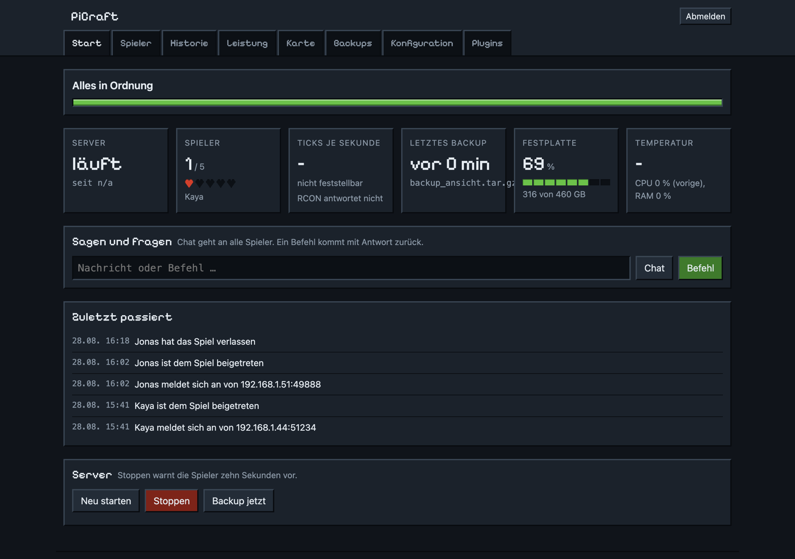
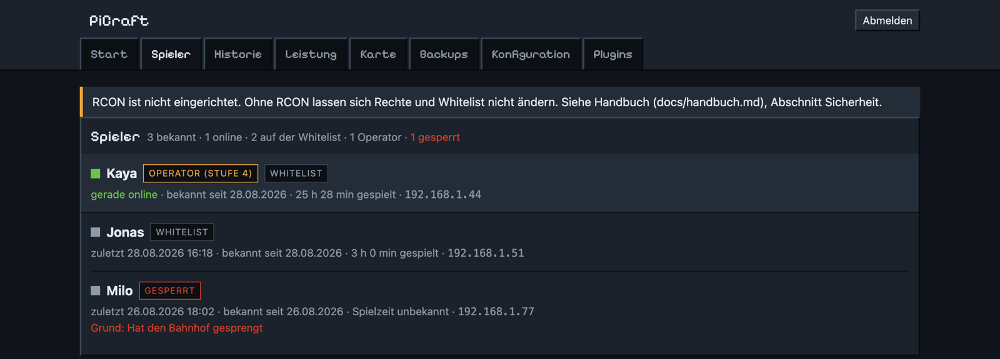
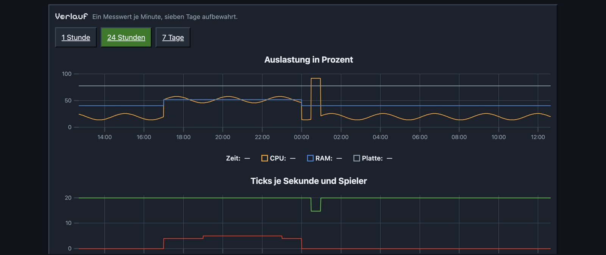
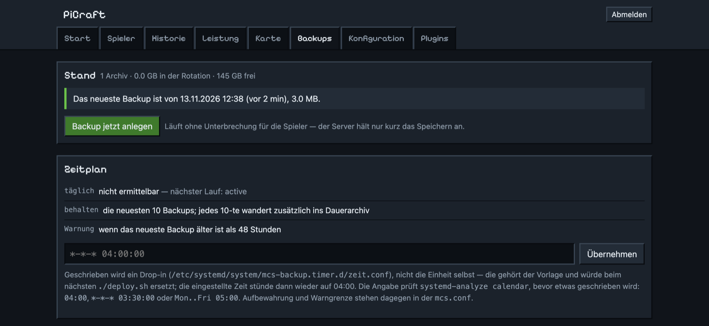
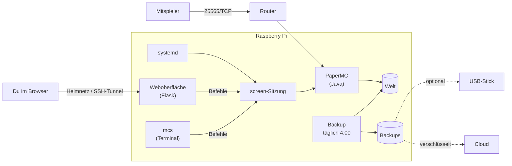

<div align="center">


# PiCraft

**Dein eigener Minecraft-Server auf dem Raspberry Pi — einmal einrichten, danach läuft er von selbst.**

[](VERSION)
[](https://papermc.io)
[-6cc24a)](server/versions.env)
[](#voraussetzungen)
[](LICENSE)

[Was ist PiCraft?](#was-ist-picraft) ·
[Installation](#installation) ·
[Bedienung](#bedienung) ·
[Technik](#technik-im-überblick) ·
[Handbuch](docs/handbuch.md)

<br>



</div>

---

## Was ist PiCraft?

PiCraft verwandelt einen Raspberry Pi in einen **Minecraft-Server für
Freunde und Familie** — ausgelegt auf etwa fünf gleichzeitige Spieler.

Den Server selbst liefert [PaperMC](https://papermc.io). PiCraft ersetzt ihn
nicht, sondern legt alles darum, was man sonst mühsam von Hand
zusammensucht: eine geführte Installation, Autostart, nächtliche und
**geprüfte** Backups, Updates mit einem Befehl und eine Weboberfläche, die
auch auf dem Handy funktioniert.

Das Ziel: **Repository klonen, `./install.sh` starten, Fragen
beantworten — danach läuft ein Server, um den man sich nicht mehr kümmern
muss.** Und wenn doch einmal etwas klemmt, sagt PiCraft es laut, statt es
zu verstecken.

### Warum PiCraft?

- 🧭 **Geführt statt gebastelt.** Ein Assistent erklärt jede Einstellung,
  schlägt einen passenden Wert vor und verändert nichts, bevor du am Ende
  „ja" sagst.
- 💾 **Backups, denen man trauen kann.** Jede Nacht, im laufenden Betrieb,
  nach dem Schreiben geprüft und rotiert — dazu ein Dauerarchiv, optional
  eine Kopie auf USB-Stick oder verschlüsselt in der Cloud.
- 📱 **Bedienung vom Sofa aus.** Spieler, Leistung, Backups, Konfiguration
  und Plugins in einer schlanken Weboberfläche — ohne App, ohne Cloud-Konto.
- 🔁 **Wartungsarm.** Startet mit dem Pi, startet nach Abstürzen neu,
  holt Paper-Updates mit einem Klick und meldet sich aufs Handy, wenn ein
  Backup schiefgeht.
- ⚡ **Auf den Pi abgestimmt.** JVM-Einstellungen auf einem Pi 5
  [nachgemessen](docs/optimierung-2026-07-27.md), und alles drumherum
  läuft so sparsam, dass der Minecraft-Server Vorrang behält.
- 🔒 **Sicher voreingestellt.** Whitelist an, Dienste nie als root,
  Firewall auf Wunsch, Weboberfläche mit Anmeldung und nur im Heimnetz.
- 🧩 **Lesbar.** Bash und ein kleines Flask-Programm, durchgehend auf
  Deutsch kommentiert. Wer den Code öffnet, soll ihn verstehen können.

## Einblicke

<table>
  <tr>
    <td width="50%">
      
      <p align="center"><b>Spieler</b> — wer online ist, wer darf, wer gesperrt ist</p>
    </td>
    <td width="50%">
      
      <p align="center"><b>Leistung</b> — eine Woche Messwerte, minütlich</p>
    </td>
  </tr>
  <tr>
    <td colspan="2">
      
      <p align="center"><b>Backups</b> — Stand, Zeitplan, zweites Ziel und Kopien außer Haus</p>
    </td>
  </tr>
</table>

<sub>Aufgenommen mit Beispieldaten aus
<a href="tests/oberflaeche-ansehen.sh"><code>tests/oberflaeche-ansehen.sh</code></a> —
damit lässt sich die Oberfläche auch ohne Pi ansehen.</sub>

---

## Installation

### Voraussetzungen

| | |
|---|---|
| **Gerät** | Raspberry Pi 5 mit 8 GB RAM (ein Pi 4 geht auch, mit kleineren Vorgaben) |
| **Speicher** | eine **SSD** (NVMe oder USB 3) — eine SD-Karte ist die häufigste Ursache für Ruckeln und Datenverlust |
| **System** | Raspberry Pi OS 64-bit (Lite reicht), mindestens 5 GB frei |
| **Netz** | Internetverbindung, am besten per Kabel |
| **Du** | Grundkenntnisse im Terminal (SSH) |

Java braucht man nicht vorher zu installieren — das erledigt der Assistent.

### In drei Befehlen

```sh
git clone https://github.com/Auktoriator/PiCraft.git
cd PiCraft
./install.sh
```

Der Assistent führt durch sechs Schritte, erklärt jede Einstellung und
schlägt einen Wert vor — die Eingabetaste übernimmt ihn:

```
  PiCraft  ·  Minecraft-Server für den Raspberry Pi
  ────────────────────────────────────────────────────────────

  Schritt 5 von 6 · Speicher und Backups

  Dieses Gerät hat 8 GB Arbeitsspeicher.

  Mehr Heap macht einen Minecraft-Server NICHT schneller — er verlängert
  nur die Pausen der Speicherbereinigung. Der Rest ist beim Betriebssystem
  als Dateicache besser aufgehoben. Empfohlen sind daher 3 GB.

  > Arbeitsspeicher für Minecraft in GB (Enter = 3): _
```

Am Ende steht eine Zusammenfassung. **Bis dahin wird nichts verändert** —
abbrechen ist folgenlos. Der erste Start dauert einige Minuten, weil die Welt
erzeugt wird.

| Aufruf | Verhalten |
|---|---|
| `./install.sh` | geführt, mit Erklärungen und Vorschlägen |
| `./install.sh --standard` | keine Fragen, überall die Empfehlung |
| `./install.sh --ohne-oberflaeche` | ohne Weboberfläche |

> [!TIP]
> **Als Erstes wird gefragt, wohin.** Vorschlag ist `~/mcs`. Wer eine SSD an
> anderer Stelle eingehängt hat, trägt sie dort ein — das ist die wirksamste
> Einzelentscheidung des ganzen Assistenten.

### Danach

| Was | Befehl |
|---|---|
| Läuft alles? | `mcs status` |
| Spieler einladen | `mcs cmd "whitelist add NAME"` |
| Kommen sie von außen rein? | `mcs erreichbarkeit` |
| Zusehen | `mcs log` |
| Alle Befehle | `mcs hilfe` |

> [!IMPORTANT]
> **Damit Freunde von außen mitspielen können, fehlen noch zwei Dinge** —
> beide haben nichts mit dem Pi zu tun:
>
> 1. **Port 25565/TCP im Router auf den Pi weiterleiten.**
> 2. **Einen festen Namen einrichten** (deSEC oder DuckDNS), weil sich die
>    Adresse der meisten Anschlüsse regelmäßig ändert.
>
> Bei vielen deutschen Kabel- und Glasfaseranschlüssen (*DS-Lite*) ist eine
> Portfreigabe allerdings wirkungslos. `mcs erreichbarkeit` erkennt das und
> sagt es, statt dich raten zu lassen. Ausführlich:
> [Erreichbarkeit von außen](docs/handbuch.md#erreichbarkeit-von-außen).

---

## Bedienung

Alles geht über **einen** Befehl im Terminal — oder über die Weboberfläche.

| Situation | Befehl |
|---|---|
| Server starten / stoppen / neu starten | `mcs start` · `mcs stop` · `mcs restart` |
| Alles an oder aus (auch über einen Neustart hinweg) | `mcs an` · `mcs aus` |
| Befehl an den Server, mit Antwort | `mcs rcon "whitelist list"` |
| Backup jetzt / zurückspielen | `mcs backup` · `mcs restore` |
| Paper auf den neuesten Build bringen | `mcs update` |
| Was läuft hier eigentlich? | `mcs version` · `mcs hardware` |
| Kopie auf USB-Stick oder in die Cloud | `mcs usb` · `mcs cloud` |
| Änderungen aus dem Repository ausrollen | `./deploy.sh`, danach `mcs restart` |

Die **Weboberfläche** lauscht standardmäßig nur auf dem Pi selbst. Am
einfachsten erreicht man sie per SSH-Tunnel:

```sh
ssh -L 8080:localhost:8080 pi@<pi-adresse>
# danach im Browser: http://localhost:8080
```

Dauerhaft im Heimnetz oder über [Tailscale](docs/handbuch.md#zugriff-über-tailscale)
geht auch — ins offene Internet gehört sie nie.

---

## Technik im Überblick

| Baustein | Umsetzung |
|---|---|
| Minecraft-Server | [PaperMC](https://papermc.io) 26.3, Version fest in [`versions.env`](server/versions.env) |
| Laufzeit | Java 25, angepasste Aikar-Flags, 3 GB Heap auf einem 8-GB-Pi |
| Dienste | systemd startet und überwacht eine `screen`-Sitzung mit dem Server |
| Backups | `tar.gz` im laufenden Betrieb (`save-off` → Archiv → Prüfung → `save-on`), Rotation, Dauerarchiv |
| Kopien außer Haus | USB-Stick mit LED-Rückmeldung, Cloud über `rclone` — nur verschlüsselt |
| Weboberfläche | Flask + Jinja + HTMX, kein Build-Schritt, kein CDN — funktioniert offline |
| Messwerte | CPU, RAM, Temperatur, TPS minütlich in SQLite, eine Woche lang |
| Meldungen | ntfy aufs Handy bei einem fehlgeschlagenen Backup — und Entwarnung |
| Name im Internet | deSEC (mit SRV-Eintrag) oder DuckDNS, alle 5 Minuten nachgeführt |
| Weltkarte | Pl3xMap, optional öffentlich hinter nginx mit eigenem Zugangstor |



**Die Grundidee:** Eine einzige `screen`-Sitzung enthält den Server. Alles, was
mit ihm sprechen will — `mcs`, die Weboberfläche, das Backup —, schickt
Befehle in genau diese Sitzung. systemd sorgt dafür, dass sie immer läuft.
Alle Pfade und Namen stehen an einer Stelle: in der `mcs.conf` der
Installation.

**Bewusst nicht dabei:** Docker, Node/npm, ein CDN oder ein Build-Schritt.
Jedes Bauteil, das der Pi nicht braucht, nimmt dem Minecraft-Server Rechenzeit
oder Speicher — und macht den Code für Einsteiger schwerer lesbar.

Repository und Installation liegen getrennt:

```
~/PiCraft    ← dieses Repository (Vorlage)
~/mcs        ← die laufende Installation: Welt, Konfiguration, Backups
```

---

## Dokumentation

| | |
|---|---|
| 📘 [**Handbuch**](docs/handbuch.md) | Alles im Detail: Installation, Update, Restore, Backups, Sicherheit, Tailscale, DNS, Weltkarte, Fehlersuche |
| 🔒 [Sicherheit melden](SECURITY.md) | Wie man eine Sicherheitslücke meldet |
| 🧪 [Auf dem Pi prüfen](PRUEFEN-AUF-DEM-PI.md) | Was sich nur auf echter Hardware testen lässt — mit Ergebnissen |
| 📋 [Lastenheft](docs/lastenheft-minecraft-server.md) | Was PiCraft können soll und warum |
| ⚙️ [Messprotokoll](docs/optimierung-2026-07-27.md) | Wie die JVM-Einstellungen auf dem Pi 5 entstanden sind |

## Mitentwickeln

```sh
make                        # Syntax, pyflakes, shellcheck, Konfigvorlagen
bash tests/abnahme.sh       # volle Installation in einem ARM64-Container
./tests/oberflaeche-ansehen.sh   # Weboberfläche mit Beispieldaten, ohne Pi
```

Code, Kommentare, Oberfläche und Commit-Nachrichten sind auf Deutsch.
Kommentare erklären das *Warum*, nicht das *Was*. Mehr dazu im
[Handbuch](docs/handbuch.md#für-entwickler-prüfungen-und-abnahmetest).

## Lizenz

PiCraft steht unter der [MIT-Lizenz](LICENSE)
([deutsche Übersetzung](docs/lizenz-deutsch.md), unverbindlich). Minecraft
und PaperMC haben eigene Lizenzbedingungen, siehe [papermc.io](https://papermc.io)
und die [Minecraft-EULA](https://aka.ms/MinecraftEULA). Die mitgelieferten
Fremdteile der Weboberfläche nennt [`admin/static/HERKUNFT.md`](admin/static/HERKUNFT.md).

<div align="center">
<sub>Mit Liebe gemacht für einen kleinen Server unter dem Schreibtisch.</sub>
</div>
